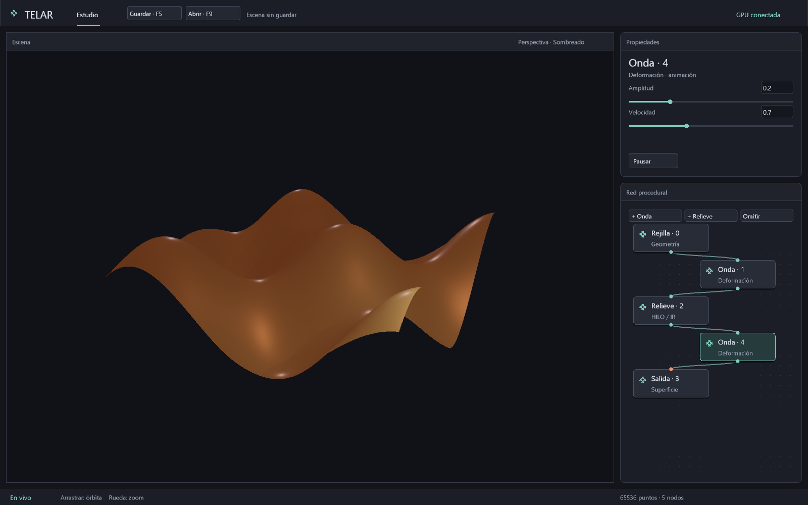

# TELAR 3D

> Los hilos pasan por los nudos, y el telar teje mundos 3D.

Un sistema 3D procedural **propio**, basado en nodos, inspirado en lo que enseña Houdini Apprentice. No para competir en el mercado, sino para **encararlo de verdad con programas**: entender cada punto, cada atributo y cada ecuación, y construirlo en Rust con control total.

**La estrella del norte:** una **esfera de fuego ultrarrealista**, simulada y renderizada entera en la GPU. Esta vez no manda la CPU: **manda la GPU**.

**Ya funciona la primera ruta procedural residente:** el visor predeterminado
genera una rejilla, la deforma y calcula normales con kernels GPU; también lee
en GPU los argumentos de despacho y dibujo. `cargo run -p telar-app --release`
la muestra. La CPU envía parámetros, cámara y el lote; la geometría permanece
en GPU. La esfera histórica se conserva con `--esfera-cpu`.
El relieve del visor ya se compila desde el IR tipado de **HILO**, con intérprete
CPU para verificar los resultados. La sintaxis textual del lenguaje sigue pendiente.

**Coordinador GPU propio:** `telar-kernel` reúne el ABI y servicios internos para
rehacer topología, suspender y reanudar trabajo mediante un buzón residente.
El visor usa ese coordinador; trabajadores GPU pueden emitir solicitudes sin
descargarlas a CPU. Es el primer contrato de servicios para esta ruta, todavía
sin cola general, asignador GPU de memoria ni administración completa del grafo.
Ver [su contrato y alcance](crates/telar-kernel/README.md).
Los próximos pasos y la elección de SPIR-V están anotados en
[el rumbo del kernel](docs/RUMBO-KERNEL.md).

**Arranque TLAR v1:** el visor ya sube un encabezado con identidad, límites y
memoria local anunciada de la GPU. Un guardián GPU comprueba contrato y regiones
antes de habilitar geometría y servicios. El bloque es independiente de Windows;
la aplicación mantiene su backend Win32/Vulkan. [Formato y pruebas](docs/ARRANQUE-GPU.md).

**Primer estudio visual:** visor amplio y grafo con nodos seleccionables y arrastrables, inspector propio por nodo: resolución, onda, relieve y salida, con pausa y materiales. La interfaz se dibuja en Vulkan
y deja el cálculo procedural en GPU. Ya crea Ondas/Relieves con parámetros independientes y conexiones validadas
dentro del dominio de una rejilla.

Tipografía proporcional con antialias, realce de controles al pasar el cursor y
selección de nodos con Tab. El atlas se prepara una vez y permanece en GPU.

**Estilo nativo inspirado en CSS:** `telar-estilo` centraliza colores, cajas,
tipografía y estados en `crates/telar-estilo/temas/telar.css`. Paneles, campos y
nodos comparten reglas de estilo; `--estilo mi-tema.css` carga personalizaciones
al arrancar, sin recompilar. Sigue usando el renderizador Vulkan.

**Archivo propio `.tlar`:** exporta e inspecciona el contrato de arranque y su
coordinador SPIR-V en v1. **V2 guarda la cadena histórica y V3 el grafo editable**: parámetros, cámara,
fase y posiciones, con Guardar/F5 y Abrir/F9. [Uso y límites](docs/ESCENAS.md).
**+ Onda / + Relieve**, puertos y omisión ya modifican el cálculo GPU.
[Números editables y contrato del grafo](docs/GRAFO-EDITABLE.md).
Una rejilla y ocho operaciones como máximo; varios objetos y render progresivo siguen pendientes.
Ver [el formato](docs/FORMATO-TLAR.md) y el ejemplo de `docs/ejemplos/`.

**Render separado:** `telar-render` genera los shaders originales de materiales
GGX, luces y exposición. El estudio ya incluye luz de área y autosombras aproximadas
de la rejilla; el kernel omite deformación cuando sus parámetros no cambian.
[Contrato y mediciones GPU](docs/RENDER-AREA.md). Transporte de luz progresivo y
volúmenes siguen pendientes.

Los ajustes de cada etapa ya modifican cálculo o sombreado.
[Configuración de los nodos](docs/NODOS-PARAMETROS.md).

**Ruta de producción:** [estado, motivos y próximos hitos](docs/RUTA-PRODUCCION.md).
Salida permite elegir MSAA 1x/2x/4x en vivo y muestra el soporte efectivo;
[controles y comparación](docs/CALIDAD-RENDER.md). El visor suaviza los contornos;
[diagnóstico, comparación y coste](docs/ANTIALIAS.md).

**Semáforos obligatorios:** cada carpeta fuente/configuración/documentación declara
ROJO crítico, AMARILLO probable o VERDE seguro en su contexto y explica su consumo.
El guardián bloquea carpetas sin informe. [Política](docs/SEMAFOROS.md),
[mapa](docs/MAPA-SEMAFOROS.md).

| Pieza | Nombre | Qué es |
|---|---|---|
| El programa | **TELAR** | el telar procedural: no se modela a mano, se teje con reglas |
| El núcleo | **NUDO** | geometría, atributos y el grafo que cocina; `no_std` |
| El lenguaje | **HILO** | el lenguaje de los nodos; se compila a SPIR-V y corre en los hilos de la GPU |

## Por qué así

- **Rust:** seguridad de memoria por defecto, y `unsafe` solo donde se habla con el sistema (Vulkan, Win32), marcado y vigilado.
- **`no_std` en el núcleo:** NUDO y HILO no dependen de ningún sistema operativo. Hoy corren en Windows; mañana, sin cambiar una línea, en Linux o en BMO-X.
- **Control total:** cero dependencias en el código. Vulkan y Win32 se hablan a mano, como VERX Desktop habla con WebView2. Los SPIR-V los emite nuestro propio compilador. Las herramientas externas de *verificación* sí valen (capas de validación de Vulkan, `spirv-val`, Houdini como referencia), igual que QEMU en BMO-X: miden, pero no forman parte del programa.
- **La GPU manda:** los datos viven en la GPU de principio a fin. La CPU solo envía parámetros; la GPU decide el trabajo siguiente (dispatch indirecto, colas en la GPU).
- **Guardianes:** marca lo peligroso, hazlo pequeño, justifícalo y que un guardián lo vigile. Ver [docs/GUARDIANES.md](docs/GUARDIANES.md).

## Principios (desarrollo guiado por guardianes)

1. **Marca lo peligroso:** `unsafe`, memoria compartida en la GPU, barreras, atómicos. Así se acelera sin miedo en el resto.
2. **Nadie es root:** ni el autor, ni la IA, ni el compilador se saltan las reglas.
3. **La realidad manda:** el hardware real > la referencia (Houdini Apprentice) > la teoría. Si no coinciden, se investiga y se dice.
4. **Cada bloqueo enseña:** regla, motivo, culpable exacto y arreglo.
5. **Lo abierto se dice:** cada resultado lleva su etiqueta: **IGUAL**, **MÁS RÁPIDO**, **DISTINTO** u **ABIERTO**.

## Los planes

| Documento | Qué contiene |
|---|---|
| [docs/ARQUITECTURA.md](docs/ARQUITECTURA.md) | los crates aislados, qué hace la CPU y qué la GPU, el flujo de un fotograma |
| [docs/HOUDINI-MAPA.md](docs/HOUDINI-MAPA.md) | cada contexto de Houdini Apprentice y su equivalente en TELAR, con prioridad |
| [docs/MATEMATICAS.md](docs/MATEMATICAS.md) | la matemática necesaria y de qué artículo o libro sale |
| [docs/ESFERA-DE-FUEGO.md](docs/ESFERA-DE-FUEGO.md) | la simulación y el render de la esfera de fuego, paso a paso en la GPU |
| [docs/GUARDIANES.md](docs/GUARDIANES.md) | las reglas y por qué existen |
| [docs/PLAN.md](docs/PLAN.md) | las fases, cada una con su demo y su «hecho cuando» |
| [docs/REVISION-GPU.md](docs/REVISION-GPU.md) | estado real del cocinado y próximo hito: generación, deformación y decisiones residentes en GPU |

## La máquina de referencia

AMD Ryzen 5 5600X · NVIDIA GeForce RTX 3060 · Windows 11 · Vulkan 1.4 (SDK 1.4.350) · Rust 1.99.

Todas las cifras de rendimiento se miden aquí y se publican con la máquina al lado.
