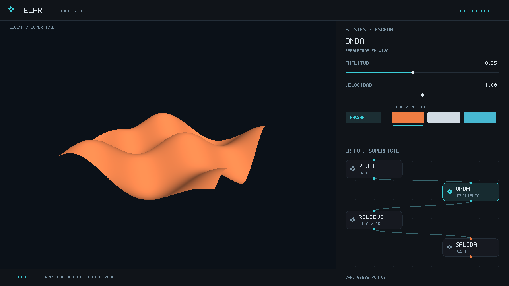

# TELAR UI · primer estudio nativo

Interfaz pura en `no_std + alloc`, sin crates externos ni conocimiento de Vulkan,
Win32, NUDO o HILO. Produce triángulos 2D y consume posiciones de ratón; la app
conecta eventos, parámetros y renderizado. No se modifica la geometría 3D en CPU.

## Qué funciona

- Grafo con nodos seleccionables y arrastrables: rejilla, onda, relieve y salida. La preparación de
  argumentos GPU es interna y no ocupa un nodo visual.
- Inspector con controles globales de amplitud, velocidad, pausa y tres colores
  de vista previa. Seleccionar un nodo cambia selección y título; aún no expone
  parámetros distintos por nodo ni su resultado intermedio.
- El visor central recibe órbita y zoom; arrastrar un deslizador no orbita.
- Visor a la izquierda; ajustes arriba a la derecha y lienzo de grafo debajo,
  tomando la distribución de la referencia aportada por el usuario.
- Identidad propia: símbolo de tejido, tarjetas redondeadas, puertos y cables
  Bézier. Los cables siguen el movimiento; las posiciones relativas se conservan
  al redimensionar. La selección aparece por encima de nodos superpuestos.
- Composición grafito/cian/cobre, puntos discretos y controles mínimos.
- Bajo 720×600 se ocultan paneles para conservar un visor utilizable.

La red todavía no permite reconectar cables, crear operaciones,
guardar escenas ni inspeccionar tablas de atributos. Los colores de vista
previa no son materiales PBR. La fuente 5×7 es provisional: faltan tipografía
vectorial, escalado DPI completo, accesibilidad y navegación por teclado de
todos los controles. Espacio pausa/reanuda desde la ventana.
Mover un nodo cambia la disposición visual; el orden y las conexiones de las
cuatro etapas de ejecución siguen fijos. No se presenta como edición de topología.

## Responsabilidades

| Archivo | Función |
|---|---|
| `src/lib.rs` | distribución, estado y consumo de eventos de controles |
| `src/dibujo.rs` | composición de paneles, red e inspector |
| `src/lienzo.rs` | triángulos y glifos provisionales |
| `tests/estudio.rs` | límites, interacción, distribución y geometría finita |

La app compone triángulos solo al cambiar estado o tamaño. El backend conserva
dos buffers mapeados y solo copia la revisión nueva cuando la valla del juego
permite escribir. El overlay se dibuja en GPU, sin profundidad, después de la
escena. La CPU prepara esta geometría pequeña de interfaz, separada de los datos
procedurales residentes.

`telar-app/tests/interfaz_gpu.rs` captura la escena con el overlay y verifica
píxeles y cambios reales de superficie al usar el deslizador. La captura de
esta página sale de `telar-app/examples/capturar_estudio.rs`: Vulkan real, 256²
puntos, imagen 1280×720, sin capturar otras ventanas ni una maqueta HTML.
