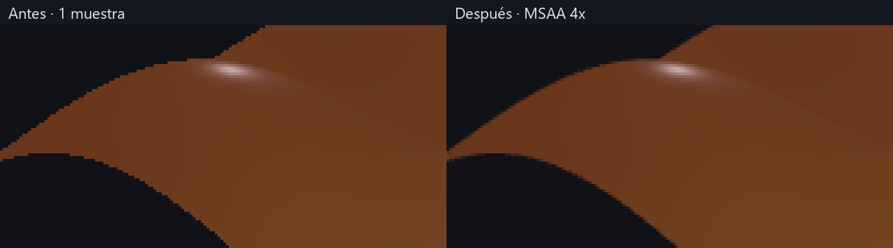

# Bordes suaves: MSAA nativo en Vulkan

La siguiente vía de investigación, distinta del MSAA ya implementado, es la
[reconstrucción temporal inspirada en el estudio de FSR](FSR-RECONSTRUCCION.md).

El contorno escalonado observado por el usuario era aliasing de cobertura: el
visor rasterizaba con una sola muestra en el centro de cada píxel. Una superficie
curva proyectada sobre píxeles enteros produce escalones, aunque tenga muchos vértices.
El usuario confirmó que se refería al borde, no a las sombras o los reflejos.



Izquierda: 1x. Derecha: MSAA 4x. Misma escena, cámara, fase, resolución y material.
Los recortes se ampliaron por vecino más próximo para mostrar la cobertura real;
no se aplicó desenfoque a la imagen. La corrección sucede en GPU durante el dibujo.

## Implementación

`Opciones::antialias` es true por defecto. El backend consulta
`vkGetPhysicalDeviceImageFormatProperties` para los usos reales de color y
profundidad. Elige 4x si ambos formatos lo admiten, en otro caso 2x y finalmente
1x. No presupone soporte por la marca de GPU. La consulta se hace al preparar
imágenes/pipelines, fuera del bucle estable.

El pipeline, profundidad y color multimuestreado usan la misma cantidad de
muestras. El renderizado dinámico resuelve el color por promedio a una imagen de
una muestra que se presenta o captura. La swapchain permanece de una muestra.
La interfaz comparte el pase y su pipeline coincide con los adjuntos. Los atlas
muestreados continúan siendo imágenes de una muestra.

Color MSAA y profundidad son persistentes en el visor y se recrean al redimensionar.
Las barreras de color/profundidad ordenan también la reutilización entre juegos en
vuelo. No hay lectura de píxeles al host ni filtrado CPU en el visor vivo. El código
se aísla en `telar-gpu/src/ffi/multimuestreo.rs`; Vulkan no entra en los crates puros.

Referencia: [Khronos, rasterización y multisampling](https://docs.vulkan.org/spec/latest/chapters/primsrast.html)
y [renderizado y resolución de adjuntos](https://docs.vulkan.org/spec/latest/chapters/renderpass.html).

## Coste medido y memoria

**DISTINTO: contornos más suaves con mayor coste.** RTX 3060 / Windows, Vulkan con
validación y sincronización activas. 1280×720, rejilla 256², fase 0,6, amplitud 0,65,
sin Relieve adicional. Dos calentamientos y nueve muestras por variante. Timestamps
de dibujo, limpieza, barreras, resolución MSAA y overlay vacío; excluyen preparación,
compute, tiempo CPU y descarga. No son FPS ni un benchmark de una producción completa.

| Variante | Mediana 1x, ms | Mediana MSAA 4x, ms |
|---|---:|---:|
| Área, cuatro muestras, sin sombra | 0,0477 | 0,1035 |
| Área, una muestra, 32 pasos de sombra | 0,2310 | 0,4204 |
| Área, cuatro muestras, 32 pasos de sombra | 0,8330 | 1,4495 |

La última variante tuvo intervalos mínimo/máximo 0,8252..0,8404 ms (1x) y
1,4456..1,4535 ms (4x). Es una ejecución local, no una garantía para otras escenas.

Para RGBA8/BGRA8 y profundidad D32, a cuatro muestras se añade color de 16 bytes
por píxel y profundidad crece de 4 a 16. Incremento lógico: **28 bytes/píxel**, unos
**24,61 MiB a 1280×720**, además de los recursos ya existentes. No es medición del
pico físico de VRAM: requisitos y alineación del controlador pueden aumentarlo.
Las capturas reservan adjuntos transitorios para diagnóstico; el visor los conserva.

No activa sombreado completo por muestra, pero cobertura, profundidad, resolución
y fragmentos de borde sí cuestan más. Los diez buffers, ocho pipelines compute,
dos grabaciones compute y transferencias de geometría permanecen iguales.

## Reproducir y verificar

```
cargo run -p telar-app --release --example medir_render -- --sin-msaa
cargo run -p telar-app --release --example medir_render
cargo run -p telar-app --example capturar_estudio -- target/bordes-1x.rgba 1280 720 3 sin-msaa
cargo run -p telar-app --example capturar_estudio -- target/bordes-4x.rgba 1280 720 3
```

`CapturaEstudio::muestras` informa las muestras reales. La prueba `antialias_gpu.rs`
compara una superficie plana de color uniforme: 1x no tiene coberturas intermedias,
MSAA sí, el centro conserva su color y el fondo distante no se mezcla. En equipos
sin soporte se verifica el fallback 1x. La prueba de ventana comprueba reutilización
y dos redimensionados bajo validación.

## Límites

Reduce los escalones del contorno; no crea detalle geométrico ni garantiza eliminar
todo aliasing a cualquier resolución. Un borde poligonal por baja resolución de
Rejilla necesita más geometría. Reflejos especulares, texturas y sombras tienen
problemas de muestreo distintos. El render progresivo HDR de la hoja de ruta tendrá
su propio muestreo y acumulación; MSAA no lo sustituye.
