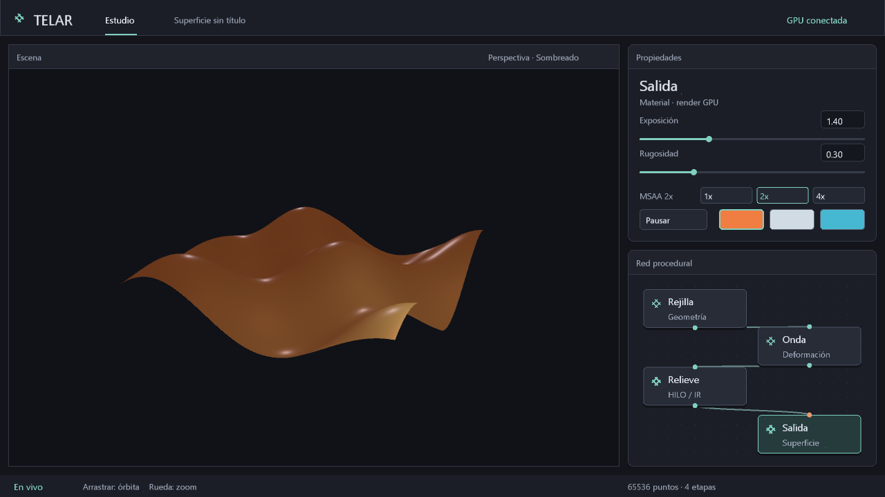

# Calidad de render como parámetro de Salida

El inspector de **Salida** expone exposición, rugosidad, material y selección
MSAA **1x / 2x / 4x**. Cada ajuste conserva su valor al seleccionar otros nodos.
La interfaz no reserva recursos Vulkan: entrega el valor a la app y el backend
valida y aplica la cantidad. Los otros tres inspectores mantienen sus controles.



El botón seleccionado indica la petición; la etiqueta `MSAA Nx` muestra las
muestras efectivas. El backend elige el mayor valor admitido que no exceda la
petición, según los formatos de color y profundidad. Solicitar 2x nunca activa 4x.
El estudio nuevo solicita 2x; las escenas conservan su elección. La API del backend
y los diagnósticos conservan 4x por defecto. No se presume soporte por fabricante.

Dirección acordada: **2x para el perfil de edición** y mayor presupuesto para
producción. El perfil final y sus controles de muestras por píxel siguen siendo
un plan; [distinción entre MSAA 16x y muestreo de producción](RUTA-PRODUCCION.md#dos-perfiles-de-calidad-edición-y-producción).
No se amplió la API actual a 8x/16x. El valor inicial del estudio se cambió después
a 2x al incorporar la [edición numérica](GRAFO-EDITABLE.md).

## Contrato y coste del cambio

`Opciones::muestras` acepta 1, 2 o 4. `antialias = false` conserva la forma antigua
de forzar 1x. `Gpu::configurar_muestras` permite cambiar en vivo y devuelve el
valor efectivo; rechaza otros valores. Las capacidades se guardan por formato
para evitar consultas repetidas al controlador en cada fotograma.

Si cambia la cantidad efectiva, el host espera a que termine el trabajo y
reemplaza los adjuntos de color/profundidad; los pipelines gráficos se adaptan
antes del siguiente dibujo. Puede producir una pausa al editar: no es un ajuste
automático gratuito por fotograma. La swapchain y el plan compute se conservan.
La reserva nueva y la antigua se solapan brevemente; su pico físico no se midió.
Un fallo al reservar adjuntos conserva los anteriores y restaura la petición del
backend; la app comunica el error por su ruta habitual.

La geometría permanece residente: cambiar MSAA no crea buffers ni pipelines
compute, no vuelve a grabar ese plan y no sube geometría desde CPU. La resolución
de las muestras ocurre en GPU. Esto no cambia el papel del host en entrada,
preparación, envío y presentación.

## Medición local: RTX 3060, Windows

1280×720, rejilla 256², fase 0,6 y amplitud 0,65, sin Relieve adicional. Validación
Vulkan y sincronización activas. Dos calentamientos y nueve mediciones por variante.
Timestamps de dibujo, limpiezas, barreras, resolución y overlay vacío; excluyen
compute, preparación, CPU y descarga. No representan FPS del estudio completo.

| Variante | 1x, mediana ms | 2x, mediana ms | 4x, mediana ms |
|---|---:|---:|---:|
| Luz de área, cuatro muestras, sin sombra | 0,0487 | 0,0840 | 0,1063 |
| Luz de área, una muestra, 32 pasos de sombra | 0,2324 | 0,3340 | 0,4242 |
| Luz de área, cuatro muestras, 32 pasos de sombra | 0,8404 | 1,1541 | 1,4510 |

En la última fila, mínimos/máximos: 1x 0,8298..1,2138 ms;
2x 1,1427..1,1622 ms; 4x 1,4450..2,1246 ms. Hubo valores atípicos en 1x y 4x.
Es una ejecución local, no una garantía para otras escenas o GPUs.

**DISTINTO:** mejor cobertura de contornos a cambio de tiempo y memoria.
2x permite escoger un punto intermedio. MSAA no arregla por sí solo reflejos,
sombras mal muestreadas ni siluetas con poca geometría.

| Muestras | Memoria lógica adicional frente a 1x, RGBA8/D32 | A 1280×720 |
|---|---:|---:|
| 1x | 0 B/píxel | 0 MiB |
| 2x | 12 B/píxel | 10,55 MiB |
| 4x | 28 B/píxel | 24,61 MiB |

Son diferencias de almacenamiento lógico; excluyen alineación del controlador,
otros recursos y el solapamiento durante el cambio. No miden consumo total de VRAM.

## Verificación y siguientes pasos

`calidad_visor.rs` pulsa los controles reales, cambia modos y redimensiona bajo
validación. Comprueba ausencia de avisos y conservación del plan compute.
`antialias_gpu.rs` comprueba cobertura parcial en capturas 2x/4x cuando se admiten;
las pruebas UI verifican pertenencia a Salida y distribución a 800×600 y tamaños
mayores. Las capturas de diagnóstico pueden descargar píxeles; el visor vivo no.

```
cargo run -p telar-app --release --example medir_render -- --muestras 1
cargo run -p telar-app --release --example medir_render -- --muestras 2
cargo run -p telar-app --release --example medir_render -- --muestras 4
cargo run -p telar-app --example capturar_estudio -- target/salida.rgba 1280 720 3 2
```

La reutilización de una imagen completa en reposo sigue pendiente; existe caché
de geometría, pero el visor continúa dibujando. Reconstrucción temporal/FSR y
acumulación HDR son trabajos posteriores. El [grafo editable](GRAFO-EDITABLE.md) permite instancias y conexiones sobre una
rejilla; [`.tlar` v2/v3 guarda sus parámetros](ESCENAS.md). Geometría general y
trazado progresivo siguen pendientes, según RUTA-PRODUCCION.md.
