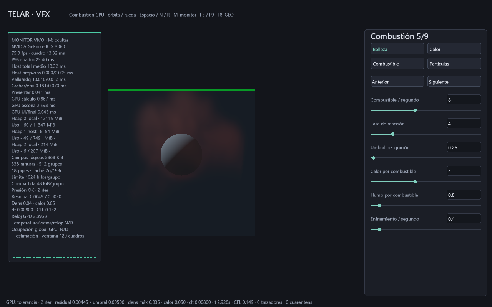

# El plan compute se graba una vez por juego y se reutiliza

29-10-2026. El visor de campos usa dos comandos secundarios compute, uno por
cuadro en vuelo. Un plan estable ya no necesita que la CPU grabe de nuevo cada
pipeline, descriptor, push, despacho y barrera en cada cuadro. Sigue enviándose
un comando primario de dibujo/presentación por cuadro; los campos, el control
de presión y el reloj de simulación permanecen en GPU.

```powershell
.\target\release\telar.exe --plano-vfx --abrir-escena referencias/plano-vfx-esfera.tlar
# Ruta anterior para comparar, con la misma escena y parámetros.
.\target\release\telar.exe --plano-vfx --sin-cache-compute --benchmark-gpu target/directa-nueva.csv --segundos 15
```

El monitor indica **caché Ng/Nr**: grabaciones de secundarios y reutilizaciones.
En 200 cuadros estables activos se esperan 2 grabaciones y 198 reutilizaciones.
El CSV conserva los 18 campos anteriores y añade `compute_grabaciones`,
`compute_reusos`, `compute_directas`: ahora son **21 columnas**, leer cabecera.
La cuenta directa solo cubre el visor con caché desactivada; los lotes HDR y las
capturas siguen su ruta directa y no participan de estos contadores.

## Clave e invalidación

Cada juego conserva 32 palabras de constantes y una versión del orden de
pasadas. Un cambio efectivo de secuencia aumenta la versión. Pasar exactamente
la misma secuencia no la cambia. Las constantes se comparan por bits; cambiar
una palabra relevante obliga a grabar de nuevo cada juego cuando queda libre.

El backend es genérico: por defecto las 32 palabras son relevantes. La app MAC
3D declara máscara `0x8888ffff`: mantiene 0..15 y los W 19/23/27/31, donde están
CFL y parámetros del pulso. Omite XYZ de cámara, que solo necesita el dibujo.
No se asumió que bastaba con las primeras 16: expansión y multiplicadores usan
palabras superiores. Los campos omitidos se envían como cero a compute y la
máscara solo puede reducirse con un contrato de shader comprobado.

La cámara no invalida compute MAC 3D. Propiedades físicas y plan sí lo hacen.
Los parámetros VFX alojados en el buffer se leen de ese mismo buffer residente;
cambiar sus valores no necesita reconstruir comandos. Reiniciar/cargar campos
conserva los buffers y también permite reutilizar los secundarios. Pausa omite
su ejecución sin borrar el plan; reanudar lo conserva. Un cambio de máscara
invalida las claves. Un cambio completo de programas/buffers crea otro estado
con caché nueva. Otros laboratorios conservan la máscara completa por prudencia.

## Sincronización

Se completa la valla habitual del juego antes de modificar su secundario. No
hay uso simultáneo de un mismo secundario ni espera global añadida por cuadro.
El primario lo ejecuta fuera de rendering dinámico, entre los timestamps que
ya rodeaban compute. El snapshot de control se copia después, como antes.
Cada secundario conserva todas sus barreras, pipelines, descriptores y pushes.
El dibujo vuelve a fijar su estado gráfico después de ejecutarlo.

La caché se destruye antes que sus pipelines/buffers y completa trabajo pendiente
antes de liberar el pool. El pool permite reiniciar comandos individuales; no
se reinicia todo el pool mientras el otro juego está en vuelo. El resize solo
reconstruye recursos gráficos, y conserva el plan compute que no depende de ellos.

## Coste y límites

CPU: comprobación de clave de 32 palabras y versión, más una ejecución de
secundario por cuadro activo. Una invalidación aún paga la grabación completa;
no se promete menor coste durante edición continua de física. Dibujo, eventos,
archivos, Vulkan y envío siguen en host. Esto es reutilización de comandos,
no generación general de comandos ni planificación de sistema operativo en GPU.

GPU: mismos despachos y barreras de cálculo, agrupados en un secundario; el
driver puede añadir coste al ejecutarlo. No se añaden buffers de estado ni
transferencias por cuadro. Se añaden un pool, dos secundarios y sus claves;
memoria interna y posible residencia VRAM del driver no medidas. No se deben
confundir esos objetos con coste cero. La salida HDR offline no se cachea aquí.

El límite de pasadas y el trabajo útil siguen siendo distintos: la GPU puede
omitir una actualización al converger, pero la secuencia acotada aún contiene
sus ranuras. Indirectos, regiones activas y mejores algoritmos siguen pendientes.

## Verificación

- **IGUAL**, RTX 3060 / Windows 11: estado completo MAC antes/después de usar
  secundarios; cambios de cámara, emisión y número de subpasos frente a ruta directa.
- **IGUAL**, misma máquina: caché VFX completa, PFM y PPM a 36 avances / 2 spp
  frente a `--sin-cache-compute`.
- Contadores verifican 2 grabaciones iniciales, reutilización posterior, nueva
  grabación al cambiar física/orden/máscara y conservación con pausa/resize.
- Ensayo nativo de 120 cuadros con resize, cero avisos contabilizados de Vulkan.

Pruebas: `telar-app/tests/cache_compute.rs` y `telemetria_gpu.rs`; también se
conservan reanudación exacta y validación SPIR-V de los kernels originales.
La comparación de coste se documenta por escena/versión, sin prometer FPS
universales ni confundir espera de valla con cálculo de física CPU.

## Comparación medida · MÁS RÁPIDO en grabación host

Release, RTX 3060 / Windows 11, validación y validación de sincronización activas,
escena `referencias/plano-vfx-esfera.tlar`, MAC 32³, visor 384², un subpaso y
200 avances por ejecución. Tres ejecuciones por ruta, orden cache/directa,
directa/cache, cache/directa. Se usa la última ventana de 120 cuadros de cada
sesión, excluyendo las dos grabaciones iniciales. No había pruebas GPU de TELAR
corriendo en paralelo; no se controlaron todos los procesos externos del sistema.

| Métrica host, mediana de 3 ventanas | Directa | Reutilizada |
|---|---:|---:|
| Grabación | 1.821 ms | 0.133 ms |
| Preparación + grabación + envío | 1.866 ms | 0.189 ms |
| Grabaciones/reusos por sesión | 200 directas | 2 grabaciones / 198 reusos |

La suma preparación/grabación/envío estuvo entre 1.835..2.338 ms en directa y
0.187..0.251 ms en reutilizada. No incluye tiempo de ejecución del shader. La
cadencia quedó entre 75.026 y 75.112 fps en ambas rutas; no se demuestra mejora
de FPS. El backend usa FIFO sincronizado. Menor grabación host deja más tiempo
dentro de la espera de valla, mientras la cadencia permanece similar; esa espera
no representa tiempo host resolviendo física. La meta de menos de 2 ms para
esas tres fases se cumple en estas observaciones, no como garantía para toda escena.

Datos completos y perfiles/configuración asociados:
[cache 1](capturas/compute-cache-1.csv), [2](capturas/compute-cache-2.csv), [3](capturas/compute-cache-3.csv);
[directa 1](capturas/compute-directo-1.csv), [2](capturas/compute-directo-2.csv), [3](capturas/compute-directo-3.csv).
Cada CSV tiene un TXT del mismo nombre con parámetros, perfil y validación.



Referencias primarias: [comandos Vulkan](https://docs.vulkan.org/spec/latest/chapters/cmdbuffers.html)
y [push constants](https://docs.vulkan.org/refpages/latest/refpages/source/vkCmdPushConstants.html).
Los secundarios fijan su propio estado; no dependen de heredar constantes del primario.
