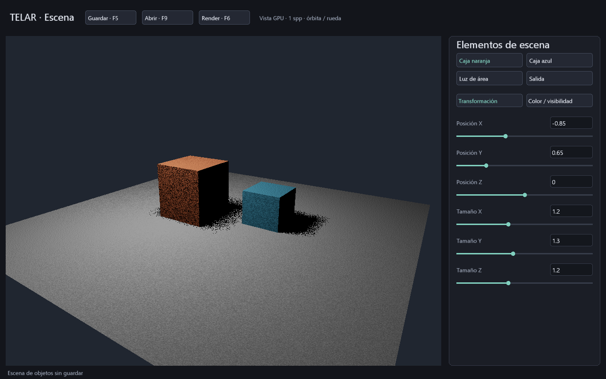

# Objetos y luz editables en TELAR

Entrega del **28 de octubre de 2026**. Editor nativo dentro del mismo ejecutable,
en modo `--estudio-rayos`. Dos cajas independientes, suelo, luz de área, cámara
y salida comparten estado entre vista previa, render HDR y escena `.tlar` v5.
El estudio procedural sigue disponible con su ruta habitual y sus versiones anteriores.



## Abrir y usar

Abre `TELAR Objetos.cmd` en la raíz del proyecto, o ejecuta:

```powershell
.\target\release\telar.exe --estudio-rayos
.\target\release\telar.exe --estudio-rayos --abrir-escena objetos.tlar
```

Selecciona **Caja naranja**, **Caja azul**, **Luz de área** o **Salida** en el
panel derecho. Cada elemento tiene dos páginas. Los colores de las etiquetas
identifican las dos cajas iniciales; puedes cambiar sus colores reales.

| Elemento | Primera página | Segunda página |
|---|---|---|
| Cada caja | Posición XYZ y tamaño completo XYZ | Color lineal RGB y visibilidad 0/1 |
| Luz de área | Posición XYZ, semilado, radiancia, sombras 0/1 | Color lineal RGB |
| Salida | Exposición, spp final, ancho, alto y semilla | Ojo XYZ y objetivo XYZ |

Pulsa un valor, escribe y confirma con **Enter**; **Escape** descarta la edición.
Coma y punto decimales se admiten. Los deslizadores actualizan el valor mientras
arrastras; la vista se recompila al soltar. Un valor inválido conserva el anterior
y muestra el motivo. La cámara también admite arrastrar para orbitar y rueda para zoom.
La órbita se aplica al soltar; la cámara no gira automáticamente.

**Guardar/F5** y **Abrir/F9** usan `objetos.tlar` en el directorio de trabajo,
o la ruta elegida con `--abrir-escena` / `--guardar-escena`. Esta última además
guarda al salir. Sin esa opción solo se escribe al solicitar Guardar.
No hay diálogo de archivos ni autoguardado implícito.

**Render/F6** calcula el HDR con los parámetros actuales y crea junto a la escena
`nombre-render-0001.pfm`, `.ppm` y `.txt`, escogiendo un número libre. No reemplaza
salidas existentes. La exportación se ejecuta en un trabajador: el botón cambia a Cancelar/F6
y la ventana muestra progreso mientras sigue atendiendo eventos. El render puede usar valores todavía no
guardados; el TXT conserva las palabras exactas de ese estado.

También puedes renderizar un archivo guardado sin abrir el editor:

```powershell
.\target\release\telar.exe --render-objetos objetos.tlar --salida target\final.pfm
.\target\release\telar.exe --inspeccionar-tlar objetos.tlar
```

## Calidad y trabajo real

La vista previa traza **una muestra por píxel físico** por fotograma. Puede tener
ruido y bordes dentados; el control spp corresponde al render final, no aumenta
las muestras de esta vista. Su viewport está limitado a 1024×768 y MSAA 1x.
La salida final conserva el presupuesto del render por lotes: hasta 512 por eje,
1024 spp y **ancho × alto × spp <= 1 048 576**. Para 256 spp selecciona primero
64×64 en Salida. El material es difuso y hay iluminación directa, sin rebotes.

Los rayos, sombras, radiancia, exposición y codificación de la vista se calculan
en GPU. La CPU prepara geometría/shaders al confirmar cambios, atiende eventos
y envía el dibujo. En estado estable no recompila ni descarga píxeles. La UI
solo se recompone ante eventos o cambio de tamaño. La exportación HDR y las
capturas diagnósticas sí esperan y descargan explícitamente el resultado.

La escena sigue incrustada en los shaders: editar reconstruye el pipeline y
espera trabajo anterior. Se sube una sola malla de pantalla de tres vértices
(72 B e índices de 12 B); las cajas se intersectan en el shader. No se afirma
que haya un almacén de mallas general residente ni un BVH. La GPU conserva los
recursos de presentación y la fuente/UI entre cuadros. Cambiar solo selección
o página no recompila el render.

La perspectiva de la vista previa usa el aspecto de su viewport; el render usa
el aspecto de la resolución final. No hay marco de recorte de cámara aún.

## Persistencia, límites y evidencia

`.tlar` v5 ocupa **184 B**, con cabecera, versión, 42 palabras de datos y CRC.
Guarda todas las propiedades y la página/elemento seleccionado, no el texto
sin confirmar ni capacidades GPU. Validación transaccional y reemplazo mediante
temporal exclusivo compartidos con el guardado anterior. El CRC detecta daños;
no autentica el archivo. Contrato exacto: [FORMATO-TLAR.md](FORMATO-TLAR.md).

Pruebas en NVIDIA GeForce RTX 3060 / Windows:

- **IGUAL:** guardar/reabrir conserva bytes y reproducir el estado conserva HDR.
- **DISTINTO:** color de luz, controles de escena y sombras afectan al render.
- Enter se procesa tras los caracteres pendientes de Windows; F5/F9/F6 se
  difieren hasta consumir el lote de eventos. Escape y rechazo de valores
  conservan la última escena válida.
- 120 fotogramas, reducción a 500×300 y restauración a 1280×800: cero avisos de
  validación. Una captura RGBA8 real verifica visualmente la vista y el inspector;
  los shaders se comprueban con `spirv-val --target-env vulkan1.3`.
- Corrupción de cada byte, parámetros inválidos con CRC recalculado y errores
  de guardado se rechazan sin truncar la escena anterior.

Coste temporal comparativo y pico físico de memoria **ABIERTOS**. El render final
mantiene 20 B/píxel de salida más 20 de descarga, código y alineación adicionales.
El visor tiene adjuntos gráficos, pipeline, fuente y dos buffers UI; la preparación
de shaders y las capturas añaden RAM/VRAM transitoria. No se promete coste cero.

Todavía son dos cajas fijas: no hay crear/borrar objetos, rotación, importación
de mallas ni conexiones de estos elementos al grafo procedural. También faltan
BVH, acumulación progresiva entre fotogramas, invalidación de historial, rebotes,
vidrio y texturas. Esta entrega cierra controles y persistencia de la escena
pequeña, sin presentar el estudio como render de producción terminado.

La separación de hilos, cancelación y trabajo en VRAM se detallan en
[RENDER-ASINCRONO.md](RENDER-ASINCRONO.md). La vista previa aún no acumula muestras.
