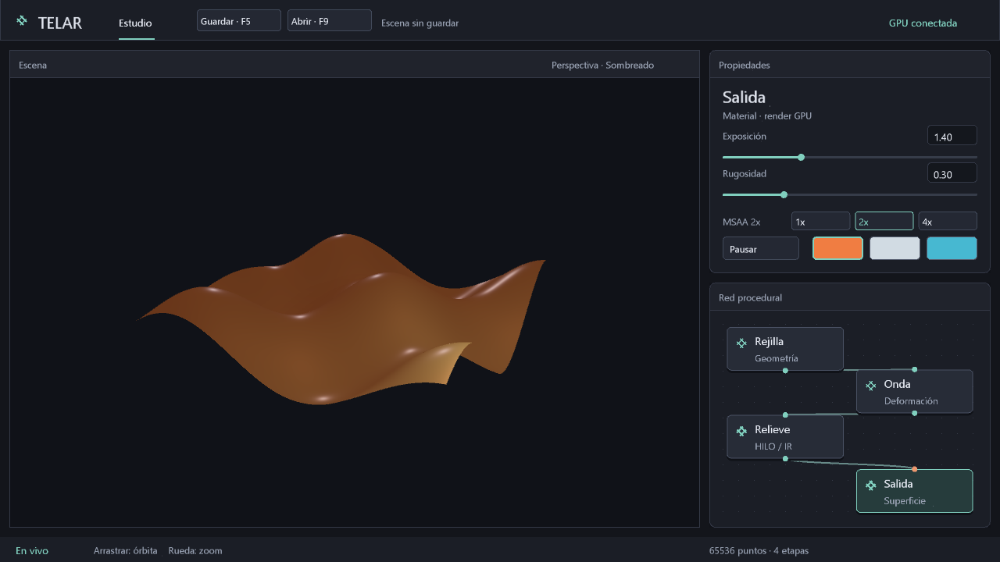

# Escenas guardables del estudio · .tlar v2

El estudio actual ya puede guardar y abrir sus cuatro etapas fijas. Es la primera
parte de P1: todavía no crea instancias de nodos ni permite reconectar el grafo.
Tampoco introduce trazado de caminos ni controles de 256 spp sin un trazador real.



## Uso

- **Guardar / F5:** escribe en la ruta activa. Sin argumentos es `escena.tlar`
  dentro del directorio de trabajo. La ruta aparece en el título y la consola.
- **Abrir / F9:** vuelve a leer esa ruta y restaura el estudio. No hay selector
  nativo de archivos todavía; para elegir otra ruta se usa la línea de comandos.
- **`--abrir-escena ruta.tlar`:** valida el archivo antes de preparar la GPU,
  reconstruye la reserva y abre sus parámetros. La capacidad guardada prevalece
  sobre `--puntos` porque define el presupuesto de la escena.
- **`--guardar-escena ruta.tlar`:** cambia la ruta activa y también guarda al salir
  normalmente. Sin esta opción no hay guardado automático al cerrar.

```
cargo run -p telar-app --release -- --guardar-escena mi-escena.tlar
cargo run -p telar-app --release -- --abrir-escena mi-escena.tlar
cargo run -p telar-app --release -- --abrir-escena mi-escena.tlar --guardar-escena otra-escena.tlar
cargo run -p telar-app --release -- --inspeccionar-tlar mi-escena.tlar
```

Se conservan lado/capacidad de Rejilla, amplitud/velocidad de Onda, factor de
Relieve, exposición/rugosidad/material/MSAA solicitado de Salida, nodo seleccionado,
pausa, posiciones normalizadas de las cuatro tarjetas, cámara y fase de animación.
La GPU destino vuelve a consultar las muestras admitidas; no se guarda el nivel
efectivo de otro dispositivo ni sus recursos Vulkan. Abrir termina arrastres y
desactiva el giro de demostración para conservar la cámara restaurada. La animación
avanza al reanudar si la escena no estaba pausada.

Los estilos CSS y las fuentes son ajustes de sesión, no recursos de escena v2;
se conservan al abrir en vivo. La luz de área sigue siendo la configuración fija
del visor actual. No hay objetos externos, texturas ni rutas a shaders ejecutables.

## Validación y errores

El archivo tiene exactamente **128 bytes**, incluyendo versión, longitud y CRC32.
Se comprueban todos los parámetros, finitud de flotantes, rangos de cámara,
posiciones y opciones conocidas antes de aplicar cambios. El lector de escena
solo lee hasta 129 bytes para detectar sobrantes sin cargar archivos enormes.
La inspección general sigue admitiendo arranques v1 y escenas v2; no crea GPU.

El guardado escribe un temporal exclusivo en el mismo directorio, lo sincroniza,
cierra y reemplaza el destino mediante `std::fs::rename`. Un error previo al
reemplazo no trunca el original y se intenta limpiar el temporal propio. No es
una garantía ante cualquier corte de energía o comportamiento del sistema de archivos;
no hay historial de versiones ni guardado automático de recuperación todavía.

En vivo, la capacidad del archivo debe coincidir con la reserva actual. Si difiere,
se conserva el estudio y se indica reiniciar con `--abrir-escena`. Los fallos de
abrir/guardar se informan en cabecera y consola; la ventana permanece abierta.
Los errores de carga inicial o guardado explícito al salir retornan fallo.
El modo histórico `--esfera-cpu` no participa en este formato procedural.

CRC32 detecta corrupción accidental, no autentica archivos. V2 contiene datos,
no código SPIR-V; abrir una escena no ejecuta código proporcionado por el archivo.
Los arranques v1 siguen siendo un tipo distinto: no se convierten automáticamente.

## Consumo y evidencia

CPU/RAM: validar y serializar un registro acotado solo al solicitar E/S; nada de
recorrer vértices en CPU. Disco: archivo de 128 B más metadatos y temporal durante
el reemplazo. La UI solo extrae una petición opcional por cuadro, sin leer el disco
en cuadros estables. Guardar/abrir es síncrono y puede interrumpir brevemente la
interacción. No añade buffers GPU, transferencias de geometría ni descargas al visor.

- `telar-ui/tests/estado.rs`: ida/vuelta, distribución, estilos, acciones únicas,
  controles ocultos y validación transaccional.
- `telar-app/tests/proyecto.rs`: truncamiento, corrupción de cada byte, versión,
  límites, reemplazo y fallos sin perder el destino; ejecutable real con reapertura
  y guardado tras 120 cuadros conserva una escena pausada byte por byte.
- `telar-app/tests/calidad_visor.rs`: botones reales, apertura en vivo, errores de
  capacidad/archivo sin alterar la escena, MSAA efectivo y validación Vulkan.
- `telar-app/tests/proyecto_render.rs`: **IGUAL, píxeles exactos** tras reconstruir
  recursos desde la instantánea; editar Relieve sí cambia la imagen. RTX 3060,
  Windows, MSAA 2x, captura diagnóstica 192×192, con validación y sin subir geometría.
  Las capturas descargan datos solo para esta comparación, fuera del visor vivo.

El formato exacto está en [FORMATO-TLAR.md](FORMATO-TLAR.md). El próximo bloque de
P1 son identificadores estables, instancias independientes, conexiones validadas
y compilación del grafo a un plan GPU. P3/P4 construirán intersecciones y acumulación
HDR antes de exponer muestras de producción con efecto real.
