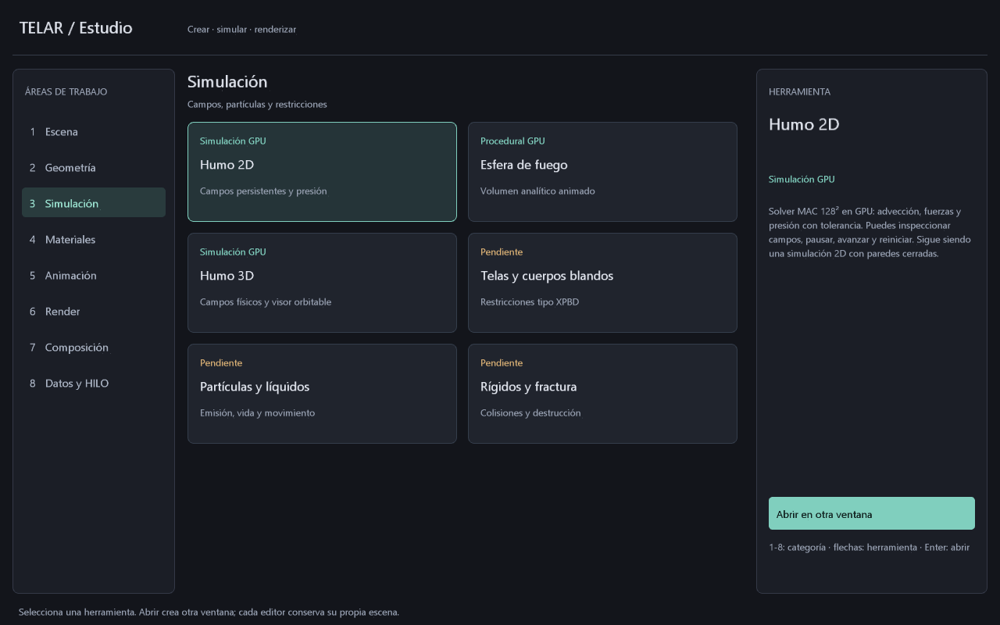

# TELAR Estudio: organización por categorías

La primera organización visual del conjunto de TELAR ya existe como centro
de herramientas nativo. Permite descubrir capacidades, leer su alcance y abrir
los editores disponibles. **Todavía no es una ventana única con proyecto,
visor, grafo e inspector compartidos.**

```powershell
cargo build -p telar-app --release
.\target\release\telar.exe --estudio
# O abrir TELAR Estudio.cmd
```

## Áreas de trabajo

| TELAR | Qué reúne | Relación conceptual con Houdini |
|---|---|---|
| Escena | Objetos, cámaras, luces e instancias | OBJ y construcción de escena |
| Geometría | Generadores, atributos, grupos y deformadores | SOP |
| Simulación | Humo, fuego, restricciones, partículas y líquidos | DOP y herramientas de simulación |
| Materiales | Superficies, volúmenes y aspecto | Grafos de sombreado/VOP |
| Animación | Curvas, claves, señales y personajes | Canales y herramientas de animación |
| Render | Iluminación, calidad, pases y exportación | Salidas y dependencias de render |
| Composición | Imágenes, capas y filtros | COP |
| Datos y HILO | Expresiones, diagnóstico, cachés y trabajos | Lenguajes, atributos y tareas |

La inspiración es la especialización por datos y operaciones descrita en
[Networks and parameters de SideFX](https://www.sidefx.com/docs/houdini/network/index.html).
Los nombres y la interfaz son propios de TELAR. La correspondencia es orientativa;
no implica compatibilidad con VEX, proyectos `.hip` ni sus contextos completos.

## Qué puede abrirse hoy

- Objetos y luz / Render progresivo: editor de escena acotada `--estudio-rayos`.
- Superficie procedural / Aspecto de superficies: estudio existente de rejilla.
- Humo 2D / Inspección de humo: laboratorio MAC `--humo`.
- Humo 3D: laboratorio MAC de 32³ con cámara orbitable `--humo-3d`.
- Esfera de fuego: volumen procedural `--fuego`, distinto de combustión simulada.

Cada tarjeta indica Disponible, Simulación GPU, Procedural GPU o Vista previa
cuando tiene un destino. Las tarjetas Pendiente y Plan futuro solo muestran su
descripción; no tienen una acción de apertura ni simulan funciones inexistentes.
El detalle mantiene visibles las limitaciones del editor seleccionado.

1–8 selecciona una categoría; arriba/abajo recorre tarjetas y Enter abre.
También puede seleccionarse una tarjeta con el ratón y pulsar Abrir en otra
ventana. Seleccionar por sí solo no inicia trabajo GPU ni abre procesos.

El centro abre **otra ventana del mismo ejecutable** con argumentos fijos,
sin usar un shell. Conserva una instancia abierta por tipo de editor durante
esa sesión; categorías que apuntan al mismo editor reutilizan ese registro.
No cierra ventanas ni guarda/reemplaza sus escenas. Cerrar el centro deja los
editores independientes abiertos. Un proyecto abierto fuera del centro no se
transfiere automáticamente a estas ventanas.

## CSS, capturas y comportamiento

El tema base sigue en `crates/telar-estilo/temas/telar.css`; las categorías y
tarjetas añaden `crates/telar-estilo/temas/estudio.css`. `--estilo tema.css`
permite personalizar el centro con el mismo subconjunto CSS nativo.
El tamaño mínimo completo es 1080×700; por debajo se muestra una indicación
para ampliar. No hay botones invisibles activos en esa vista compacta.

```powershell
.\target\release\telar.exe --estudio --categoria 3
.\target\release\telar.exe --estudio --captura-estudio target/estudio.ppm
.\target\release\telar.exe --estudio --prueba
```

La captura PPM es diagnóstica, de 1280×800, y rechaza destinos existentes.
La prueba recorre categorías, cambia de tamaño y dibuja 120 fotogramas ocultos;
no abre editores secundarios. Las pruebas de UI comprueban selección, acciones
disponibles/pendientes, CSS transaccional y límites de geometría en cuatro tamaños.
La apertura se enruta mediante un enum y argumentos conocidos, sin nombres
de programas o comandos escritos en las tarjetas.

El centro solo dibuja interfaz: no mantiene campos de humo, historial de render
ni una malla 3D. Usa swapchain, profundidad del backend, atlas y buffers UI.
CPU compone geometría al cambiar selección, tamaño o mensajes; GPU dibuja y
presenta. No se promete consumo cero. Cada editor abierto añade su propio coste.



## Siguiente integración

Para acercarse al flujo completo de una aplicación VFX:

1. Sesión de proyecto compartida con selección, cambios sin guardar e historial.
2. Paneles acoplables de visor, grafo, parámetros y datos en la misma ventana.
3. Contextos con puertos tipados: geometría, campos de simulación, materiales e imágenes.
4. Búsqueda y creación de herramientas dentro de cada contexto, con errores y coste visibles.

Estas piezas siguen pendientes. El catálogo organiza las capacidades actuales y
el plan; no sustituye el desarrollo de los solvers, materiales y herramientas.

La tarjeta **Partículas GPU** de Simulación abre `--particulas`: emisor independiente con 128 plazas, diez controles, cuatro vistas, F5/F9 v12 y F8 GEO con edad/vida. No anuncia líquidos ni acoplamiento al gas. Ver [PARTICULAS-GPU.md](PARTICULAS-GPU.md).
