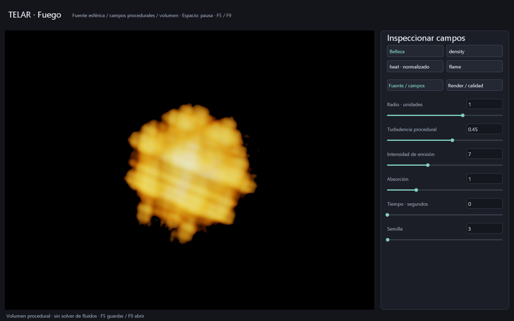

# Esfera de fuego: primera vista de volumen

Estado: **DISTINTO de Pyro; base visual, no simulación física ni render de producción terminado.**
La marcha de rayos, evaluación de campos, emisión/absorción y salida de color se
ejecutan en GPU. La CPU atiende eventos, texto, archivos, tiempo y envía constantes.
No existe una promesa de reparto fijo 90/10 ni coste cero.

## Abrir y trabajar

```powershell
cargo build -p telar-app --release
.\target\release\telar.exe --fuego
# También: doble clic en TELAR Fuego.cmd
```

- Espacio pausa/reanuda la fase procedural. El cambio de tiempo no es un paso de fluidos.
- **Fuente / campos:** radio, turbulencia, emisión, absorción, tiempo y semilla.
- **Render / calidad:** exposición y cualquier entero de **16 a 128 pasos por rayo**.
  Son muestras de integración volumétrica, diferentes de MSAA y de spp del editor de objetos.
- Clic en un número, escribir y **Enter** aplica; Escape cancela la edición.
- Belleza, `density`, `heat` normalizado y `flame` muestran las contribuciones integradas
  sobre el rayo. No son cortes de voxeles ni una tabla de valores leídos de VRAM.
- F5 guarda; F9 abre `fuego.tlar` por defecto. La escena v6 conserva ocho parámetros
  con CRC. Selección de vista, página y reproducción son transitorios.

```powershell
.\target\release\telar.exe --fuego --guardar-escena target/mi-fuego.tlar
.\target\release\telar.exe --fuego --abrir-escena target/mi-fuego.tlar
.\target\release\telar.exe --inspeccionar-tlar target/mi-fuego.tlar
.\target\release\telar.exe --fuego --captura-fuego target/fuego.ppm
```

La captura PPM es una imagen binaria sRGB de diagnóstico con la interfaz, no un HDR
ni un archivo para editar como texto. Rechaza destinos existentes. Los modos de fuego,
objetos y rejilla siguen separados: no hay todavía integración de fuego con objetos,
oclusiones, sombras o exportación HDR asíncrona.

## Matemática y límites

El shader intersecta una esfera envolvente de radio 2,4 desde cámara fija y marcha
uniformemente sobre su cuerda. Evalúa tres frecuencias sinusoidales en bases
oblicuas; perturba la envolvente radial para obtener densidad, calor y llama
procedurales. La paleta HDR es artística, **no Planck/CIE ni temperatura en kelvin**.
El tiempo cambia fases; no conserva masa, energía, presión ni velocidad.

Integra de delante hacia atrás con `a = 1 - exp(-sigma * distancia)`,
`C += T * a * fuente` y `T *= 1-a`. La absorción modifica opacidad; la intensidad
controla el término de emisión artístico. No hay dispersión, iluminación del humo,
colisiones, autoiluminación de otros objetos, bloom ni reconstrucción temporal.

La GPU usa un bucle estructurado de 16..128 iteraciones; no hay atómicos, buffers
de simulación ni historial de fuego. La reserva adicional de campos es **0 B**:
se calculan al consultar cada punto. Esto no elimina el coste de píxeles, destinos,
profundidad, malla de 84 B lógicos, atlas, UI y pipelines. Un bloque de 128 B por
dibujo transporta parámetros. Cambiar pasos recompila el shader y puede pausar la
ventana mientras se prepara el pipeline. La UI se recompone al animar el valor tiempo.

## Verificación

- `fuego_gpu.rs`: validación oficial de SPIR-V para Vulkan 1.3 a 16/64/128 pasos;
  repetibilidad de imágenes, fondo negro, centro luminoso, variación temporal,
  emisión cero, tres vistas de campos distintas y diferencia media 64/128 pasos
  inferior a 3 niveles RGBA8 en la escena de prueba de 96×96.
- `telar-ui/tests/fuego.rs`: dominios, enteros y transacción «32 + Enter».
- Prueba unitaria de archivo: ida/vuelta, corrupción de cada byte, truncamiento y exceso.
- `--fuego --prueba`: 120 fotogramas ocultos con validación Vulkan.

La diferencia entre calidades es una comprobación de regresión acotada, no una
prueba universal de convergencia física. Rendimiento y comparación con Houdini:
**ABIERTO**, sin afirmar igualdad ni velocidad superior.



El paso siguiente hacia la esfera física permanece en [ESFERA-DE-FUEGO.md](ESFERA-DE-FUEGO.md).
La organización para artistas se desarrolla en [VFX-PARA-ARTISTAS.md](VFX-PARA-ARTISTAS.md).
