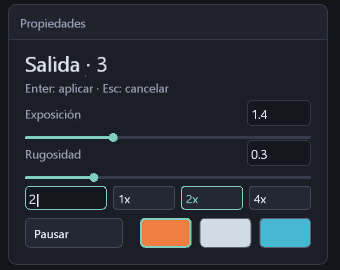

# Grafo editable residente y parámetros numéricos

El visor ya crea instancias independientes de Onda y Relieve, conecta puertos,
omite operaciones y guarda la red completa en `.tlar` v3. Es el hito básico de
P1 dentro del dominio de una rejilla; no es todavía un grafo de objetos generales.

## Parámetros por número

Clic en el valor del inspector para escribir; el primer carácter reemplaza el
valor anterior. **Enter** confirma y **Escape** cancela. Retroceso elimina y Supr
vacía. También se confirma al pulsar fuera del campo, al cambiar de nodo y antes
de F5/F9/Tab. Si el texto es inválido, el borde se vuelve rojo y el campo mantiene
el foco: se corrige o cancela antes de continuar. La escena conserva su último
valor válido durante la edición. Los atajos globales quedan suspendidos al escribir.

El inspector muestra `Enter: aplicar · Esc: cancelar` mientras se escribe. Si
el valor no es válido, muestra el rango o los niveles MSAA admitidos. Enter
(principal o numérico) y retroceso se procesan desde sus caracteres traducidos
de Windows, para conservar el orden con el texto pendiente de la misma ráfaga.
La regresión de este orden se verifica en `telar-app/tests/controles.rs`.

Se admiten decimales, coma decimal y notación científica en los parámetros reales.
Rejilla exige un entero en 2..capacidad. Se rechazan NaN, infinitos, exceso y valores
fuera del dominio. La representación muestra el valor f32 almacenado sin forzar
dos decimales; no promete precisión decimal ilimitada. El editor admite 24 caracteres
y reemplazo/retroceso, todavía sin portapapeles, selección arbitraria ni cursores laterales.

El recuadro MSAA también es editable; los botones 1x/2x/4x permanecen como atajos.
**MSAA acepta exclusivamente 1, 2 o 4** en este backend. El recuadro sin foco informa
el nivel efectivo; al editar muestra la petición. Escribir 16 o 256 no inventa
soporte ni activa un trazador inexistente. El estudio nuevo arranca solicitando
**2x**, según la preferencia del usuario; las escenas guardadas conservan su petición.
`Opciones::default()` del backend y los ejemplos diagnósticos siguen solicitando 4x.

## Operaciones y conexiones

- **+ Onda / + Relieve** crea una identidad con parámetros propios y la inserta
  antes de Salida. El inspector muestra tipo e identificador; Tab recorre todas
  las identidades. No se pisa la configuración de otra Onda.
- Clic en el puerto inferior de una tarjeta elige el productor; clic en el puerto
  superior de otra reemplaza su entrada. **Escape** cancela la conexión pendiente.
  Se rechazan ciclos, referencias ausentes, entrar a Rejilla y salir de Salida.
- **Omitir / Activar** conserva parámetros y posición; una operación omitida deja
  pasar su entrada. Fuente y Salida permanecen habilitadas.
- Arrastrar mueve la tarjeta; la **rueda sobre el lienzo** desplaza la vista vertical,
  sin mover la cámara. El contenido se recorta al lienzo para no cubrir otros paneles.
- Guardar/F5 y Abrir/F9 conservan conexiones, estados, parámetros e identidades.

Hay una fuente Rejilla, una Salida y hasta **ocho operaciones** (diez identidades
totales). Todas las operaciones son unarias, sobre altura y normales de la misma
rejilla. Se admiten ramificaciones de consumidores, pero el visor solo evalúa el
camino alcanzable desde Salida; no hay mezcla de geometrías. Los IDs son posiciones
estables por inserción; no hay borrado/compactación ni deshacer todavía. Al activar
por primera vez la red editable se ordenan las tarjetas; después conservan su posición.

## Compilación y ejecución

Al crear, conectar, omitir o confirmar un parámetro geométrico, la app valida y
compila el camino alcanzable a un programa HILO y SPIR-V. Los deslizadores de una
red editada aplican al soltar, para no recompilar por cada píxel del arrastre. El
modo histórico de cuatro etapas conserva sus uniformes vivos hasta activar la red.

El lote del grafo contiene coordinador, generador y **una pasada HILO fusionada**.
El resultado se evalúa por punto en GPU, con el mismo ABI y geometría residente.
HILO incorpora Seno/Coseno escalares, comprobados por tipos y emitidos como GLSL.std.450.
La CPU construye el programa al editar; no calcula los vértices ni recorre nodos
para cada punto/fotograma. El host sigue enviando reloj, parámetros y presentación.

Una Onda añade `A sin(2x + t v) cos(2z)` a la altura. Sus derivadas analíticas son
`2A cos(2x + t v) cos(2z)` y `-2A sin(2x + t v) sin(2z)`. Relieve multiplica altura
y derivadas acumuladas por su factor. La normal final es `normalize(-dx,1,-dz)`.
La base matemática coincide con la onda previa de `hilo-spirv/src/rejilla.rs`;
ahora puede componerse en el orden de los cables. Por ejemplo, Relieve antes de
la segunda Onda no escala esa nueva contribución; después de ambas sí lo hace.

En modo editable `t` es el reloj común, pausado con Espacio y envuelto a 1000.
Cada Onda usa su velocidad propia como multiplicador; cambiar velocidad reevalúa
la fase desde ese reloj y puede cambiar la pose. La cadena histórica v2 conserva
su reloj anterior. La caché reutiliza la geometría con parámetros repetidos; no hay
caché independiente por nodo ni reloj/cola general autónomos en GPU.

## Coste y validación

La recompilación **espera a la GPU y reconstruye el plan**, incluidos los buffers
residentes: puede pausar la edición. No es todavía recompilación incremental ni
actualización gratuita de constantes de cualquier nodo. Los recursos nuevos pueden
solaparse temporalmente con los anteriores; el pico de VRAM no se ha medido.
La aplicación reporta fallos del backend por su ruta normal de error.

En ejecución estable se conservan diez buffers, dos grabaciones compute y dos
mapeos. El plan fusionado tiene seis pipelines compute (tres por juego), frente
a ocho del plan histórico. **ABIERTO:** comparación de tiempo total y memoria física;
menos pasadas no se presenta como una aceleración medida. Compilar, validar,
recortar UI y guardar archivos consumen CPU solo en sus operaciones de edición/E/S.
Los contadores de actividad procedural corresponden al plan residente actual y
se reinician al reconstruirlo; el total de cuadros de la sesión se informa aparte.

**IGUAL dentro de 0,00003:** alturas y normales GPU frente a ecuaciones independientes
para dos Ondas, reconexión y omisión, con fases 0/0,6/1,9 y rejilla 17². RTX 3060,
Windows, validación Vulkan y de sincronización activas. No se sube geometría.
El módulo máximo pasa `spirv-val --target-env vulkan1.3`; no excede las 256 operaciones
del IR. Una escena v3 pausada conserva todos sus bytes tras 120 cuadros del ejecutable.
Las pruebas UI cubren independencia, ciclos, límites, puertos y restauración transaccional.

Quedan varios objetos, merges, borrado/deshacer, atributos generales y asignación de
materiales por objeto. La iluminación global, BVH, trazado progresivo, 256 spp,
volúmenes y exportación HDR siguen en P3..P7 de [RUTA-PRODUCCION.md](RUTA-PRODUCCION.md).
