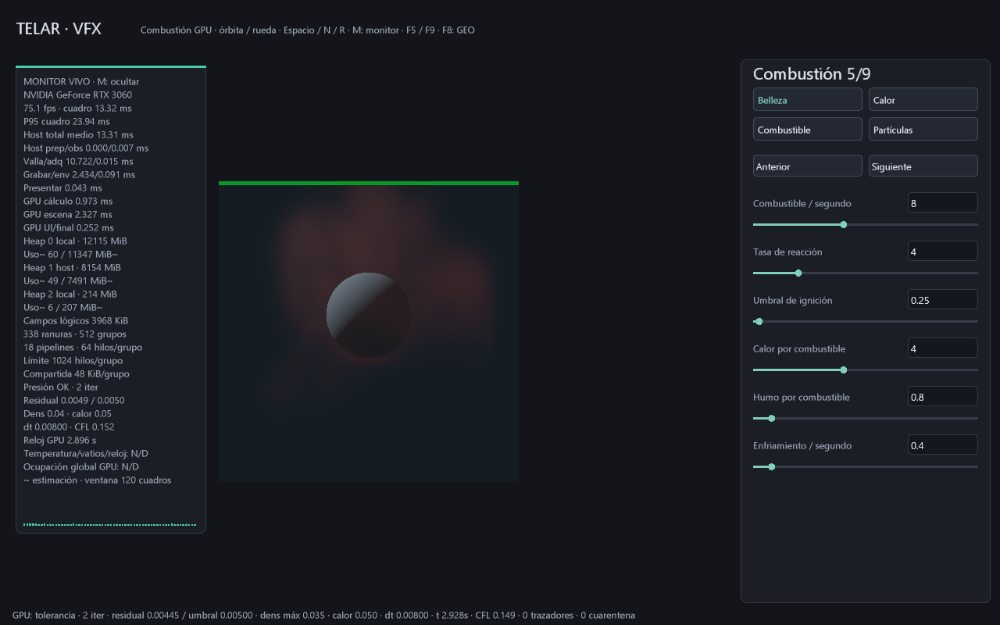

# Menos trabajo host, con esperas separadas

29-10-2026. El monitor distingue preparación, valla, observación, adquisición,
grabación, envío y presentación. La simulación y sus decisiones de dt/presión
siguen residentes en GPU. Esta entrega identifica costes y elimina una
invalidación innecesaria de interfaz; no añade un planificador autónomo nuevo.

## Qué mide

El panel muestra medias de hasta 120 cuadros host, con la misma ventana que
**Host total medio**. Los intervalos GPU conservan su última muestra terminada,
diferida. No se deben sumar esos tiempos como si correspondieran al mismo cuadro.

| Fase host | Alcance |
|---|---|
| prep | Validación de constantes, preparación de interfaz/visor/pipeline antes de presentar |
| obs | Recogida de timestamps y snapshot tras la valla existente |
| valla | Duración de vkWaitForFences sobre el juego que se reutiliza |
| adq | Duración de vkAcquireNextImageKHR, que puede esperar disponibilidad de imagen |
| grabar | Actualización de ranura, preparación del envío, grabación y reinicio de valla |
| env | Duración de vkQueueSubmit en host |
| presentar | Duración de vkQueuePresentKHR en host |

Son tiempos de pared de esas llamadas, incluidos posibles bloqueos internos del
driver. No miden tiempo de ejecución del hilo ni porcentaje de utilización CPU.
VSync, compositor y disponibilidad de imágenes pueden influir en la cadencia.
El total contiene además el pequeño trabajo del envoltorio entre fases; no se
exige igualdad exacta de sus sumas. Recrear swapchain queda fuera del desglose
de sus fases normales. El arranque puede incluir construcción de pipelines;
para comparar estado caliente, espera al menos 120 cuadros.

`--benchmark-gpu target/medicion-nueva.csv` conserva los diez primeros campos
del CSV anterior y añade ocho: siete medias host y su total. El CSV tiene ahora
18 columnas, identificadas por cabecera. El TXT conserva esas medias en texto,
perfil, configuración y último estado de control. Los resultados de sesiones
anteriores no se reemplazan.

## Trabajo CPU que se eliminó

El laboratorio antes marcaba su interfaz como sucia ante todo evento de ratón.
Ahora movimiento libre, órbita y rueda actualizan entrada/cámara sin volver a
generar ni subir los triángulos de propiedades. Un deslizador activo sí invalida
el panel. Clics, edición, cambios de tamaño y refresco del monitor conservan la
actualización necesaria. El visor continúa recibiendo su cámara cada cuadro.

No se ha publicado una ganancia de FPS por este cambio. La prueba de entrada
comprueba que órbita cambia la cámara sin invalidar propiedades, y que arrastrar
un control sí solicita actualización. Es una reducción de trabajo identificable,
sin mover interacción artística a un shader ni alterar el estado físico.

## Costes y comprobación

Se añaden lecturas de reloj monotónico cuando el monitor está activo y una
ventana de hasta 120 registros host en RAM. No se añaden buffers GPU, descargas,
envíos, esperas o cambios de sincronización. El snapshot/timestamps del monitor
conservan el coste documentado en [MONITOR-GPU.md](MONITOR-GPU.md). M apaga
medición; la optimización de invalidación UI permanece activa.

Pruebas: `telar-app/tests/telemetria_gpu.rs` verifica fases finitas/no negativas,
CSV de 18 columnas y los contratos previos de snapshot, redimensionado y apagado.
`humo_entrada::tests::solo_el_deslizador_invalida_el_overlay_al_mover` verifica
cámara y controles. Se conserva comparación exacta de campos y reanudación.
La captura y el CSV asociados son observaciones de esta escena en RTX 3060 con
validación activa; no establecen una meta universal de 5 ms o de 1–2 ms host.

Observación release, RTX 3060, validación activa, escena de esfera, 200 avances:
última ventana de 120 cuadros con host total medio 13.313 ms, valla 10.722 ms,
grabación 2.434 ms, envío 0.091 ms y preparación 0.000303 ms. La cadencia fue
75.07 fps. No constituye comparación antes/después ni velocidad universal.
[CSV completo](capturas/host-envio.csv) y [configuración/perfil](capturas/host-envio.txt)
permiten revisar la observación; sus muestras GPU son las últimas disponibles,
mientras las fases host son medias. La preparación/grabación/envío sumaron
aproximadamente 2.525 ms en esa ventana. La meta de 2 ms permanece **ABIERTO**.

## Qué falta para reducir más la intervención host

1. Reutilizar comandos de simulación pregrabados, invalidando por cambios de plan
   o parámetros relevantes. Hoy aún se graba la secuencia acotada por cuadro.
2. Ampliar trabajo indirecto decidido en GPU y compactación de regiones activas,
   con presupuestos de memoria y validación de dependencias.
3. Medir cada cambio con escena/configuración iguales, estado caliente y semáforos
   de error. Separar cadencia de presentación de duración de ejecución GPU.

La CPU mantiene Vulkan, eventos, archivos y envío. El objetivo medible es reducir
preparación/grabación/envío innecesarios manteniendo estabilidad y resultados;
el tiempo dentro de una espera no prueba que la CPU esté resolviendo la física.
