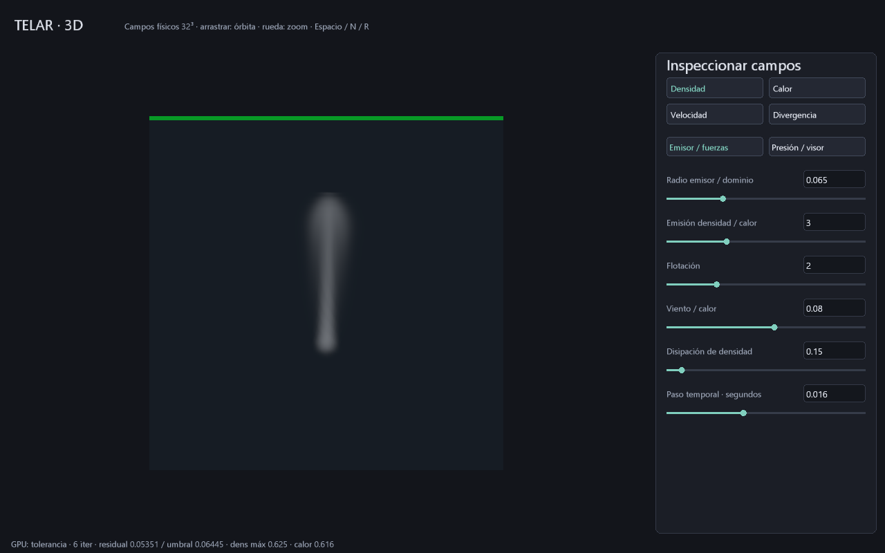

# Humo MAC 3D: primer volumen físico residente

Entrega del 28 de octubre de 2026: prototipo denso de **32³ celdas**, con tres
componentes de velocidad MAC, densidad y calor. Cada subpaso ejecuta en GPU advección
semi-lagrangiana trilineal, emisión esférica continua, flotación/viento y proyección
de presión. La CPU mantiene eventos, cámara, archivos y envíos Vulkan.

```powershell
cargo build -p telar-app --release
.\target\release\telar.exe --humo-3d
# También: TELAR Humo 3D.cmd, o Estudio > Simulación > Humo 3D.
```

Arrastrar el visor orbita; rueda acerca/aleja. Espacio pausa, N avanza un paso,
R reinicia los campos y D solicita **64 B** de resumen. El panel permite editar
números con Enter y arrastrar controles; las páginas separan emisor/fuerzas de
presión/visor. Densidad, calor, velocidad y divergencia se inspeccionan por separado.
La franja verde/amarilla/roja indica tolerancia/límite/invalidez del último paso.
Mover la cámara y cambiar exposición/vista conservan los campos.

F5/F9 guarda/abre parámetros `.tlar` **v10, 72 B**; no guarda campos ni cámara. V9 migra con un subpaso y sin obstáculo.
V8 identifica humo 2D y se rechaza en este modo para evitar reinterpretarlo.
Abrir o reiniciar limpia el volumen. Fuente y valores se reconstruyen desde cero.

```powershell
.\target\release\telar.exe --humo-3d --guardar-escena humo3d.tlar
.\target\release\telar.exe --humo-3d --abrir-escena humo3d.tlar
.\target\release\telar.exe --humo-3d --pasos 180 --captura-humo target/volumen.ppm
.\target\release\telar.exe --inspeccionar-tlar humo3d.tlar
```

La captura rechaza destinos existentes y espera/descarga solo por solicitud.
No hay lecturas de campos por cuadro en el visor vivo. Los diez parámetros tienen
los mismos dominios que [presión adaptativa](PRESION-ADAPTATIVA.md).
Calor es una magnitud normalizada, todavía no temperatura en kelvin.

## Método y contrato de memoria

El dominio unitario tiene paredes cerradas con flujo normal cero y presión
Neumann. Las velocidades se sitúan en caras; los escalares en centros. El
Laplaciano usa seis vecinos reales, con gradiente/divergencia compatibles.
Jacobi amortiguado (2/3) se revisa tras pares de iteraciones; conserva presión
entre pasos. La GPU aplica el criterio `max(abs(residual)) <= max(atol, rtol*max(abs(div)))`.
Al agotar el presupuesto sigue mostrando el error; no declara convergencia.

El estado contiene diecisiete planos f32 de N³ palabras:

| Planos | Contenido |
|---|---|
| 0–4 | u, v, w, densidad, calor |
| 5–9 | Los cinco campos provisionales |
| 10–13 | Divergencia previa, qA, qB y divergencia posterior |
| 14–16 | Residual absoluto, reducción parcial y control global |

Los límites se validan antes de reservar: N=4..64, presupuesto par=2..128,
16 programas únicos y hasta 1316 posiciones de despacho (338 con 64 iteraciones y dos subpasos); el plan histórico sin tiempo conserva 14 programas.
La GPU desactiva el contenido de las pasadas restantes al converger; la CPU sigue
registrando el plan acotado completo. No es despacho indirecto de presión.

Reserva lógica de campos más palabra auxiliar: **68*N³+4 B**; a 32³ son
**2 228 228 B**, a 64³ son **17 825 796 B**. No incluye adjuntos, atlas, pipelines,
alineación ni staging de diagnósticos. No se ha medido el pico físico ni FPS.
El backend genérico admite hasta veinte palabras por elemento, con tope adicional
de **64 MiB**; esta configuración queda por debajo.

## Qué dibuja y qué falta

El visor integra emisión/absorción artística sobre el campo trilineal, con 64
muestras por rayo y área máxima 512×512. La cámara solo modifica el dibujo.
Todavía no hay luz volumétrica, sombras propias, dispersión ni temperatura física.
Este visor diagnóstico no es render volumétrico de producción.

El emisor es continuo y fijo. La advección difunde y no conserva masa exactamente;
el nuevo [control temporal y esfera](TIEMPO-COLISION-3D.md) añade subpasos y predictor CFL residente. El límite ±0.8 se aplica a
velocidades provisionales, no demuestra estabilidad del sistema. Una fuente menor
que una celda puede quedar insuficientemente resuelta. Hay una esfera estática voxelizada; no hay colisionadores generales,
combustible/reacción, expansión explosiva, turbulencia controlada, regiones dispersas,
chispas, caché de campos ni secuencia HDR de volumen.

El recorrido completo y sus criterios están en
[PLAN-EXPLOSION-PRODUCCION.md](PLAN-EXPLOSION-PRODUCCION.md).
El siguiente hito físico es completar colisiones móviles y preparar reacción. La primera entrega de tiempo/colisión está documentada por separado.

## Evidencia

`tests/volumen_gpu.rs` valida los catorce kernels y el fragmento con `spirv-val`,
compara los primeros catorce planos a 9³ con una referencia escalar independiente
(error absoluto menor que 0.0003), comprueba reducción de divergencia, convergencia
en vacío y con flujo, presupuesto agotado, rechazo de presión no finita,
repetibilidad, fuente, pausa, vistas y reinicio.
La cámara cambia la imagen sin cambiar bytes del estado. La referencia CPU solo
se ejecuta en pruebas. La configuración prueba CRC, dominios y rechazo cruzado 2D/3D.

Máquina: Windows 11, NVIDIA GeForce RTX 3060. Captura real a 180 pasos:
6 iteraciones finales, residual 0.05351 frente a umbral 0.06445, densidad máxima
0.625 y calor máximo 0.616; cero avisos de validación Vulkan del producto.
La ejecución nativa de 120 cuadros con redimensionado y reapertura v9 terminó
también sin avisos; `cargo verify` comprueba el conjunto, incluida la ruta 2D.
No es una comparación de rendimiento o calidad contra Houdini: **ABIERTO**.



Implementación propia apoyada en métodos publicados, sin copiar código:
[GPU Gems 3, capítulo 30](https://developer.nvidia.com/gpugems/gpugems3/part-v-physics-simulation/chapter-30-real-time-simulation-and-rendering-3d-fluids)
y [funcionamiento de Pyro de SideFX](https://www.sidefx.com/docs/houdini/pyro/background.html).
