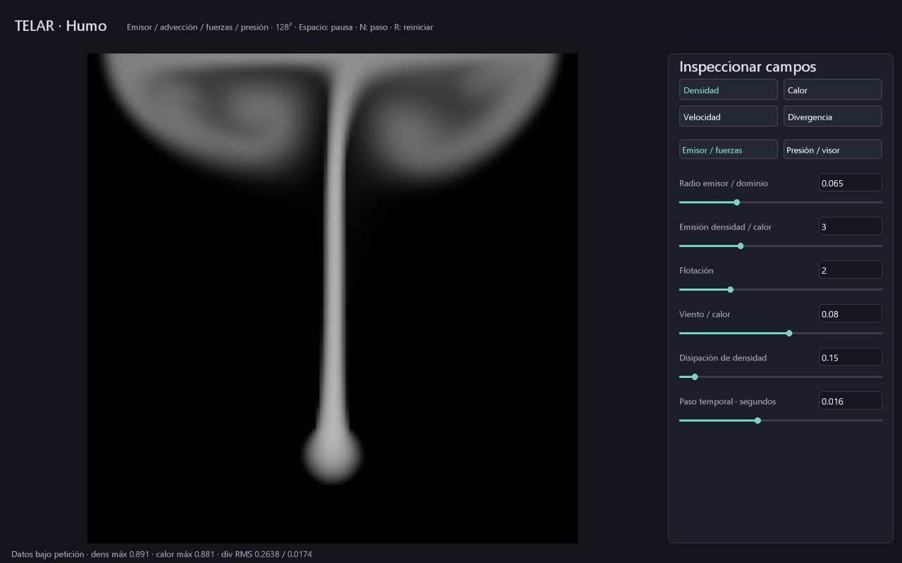

# Humo 2D con estado persistente en GPU

Estado: primer solver acotado; **no es Pyro 3D ni una simulación de producción**.
El [control adaptativo de presión](PRESION-ADAPTATIVA.md) ya está integrado; la ruta fija permanece como referencia de pruebas.
Se distingue de la esfera de fuego procedural: ahora cada paso lee campos del
paso anterior, los transporta y resuelve una aproximación de presión.

## Abrir el laboratorio

```powershell
cargo build -p telar-app --release
.\target\release\telar.exe --humo
# O abrir TELAR Humo.cmd
```

La rejilla fija del editor es **128×128**, con dominio cuadrado. El emisor circular
inyecta densidad y calor cerca de la parte inferior; el gas caliente asciende.
Las paredes son cerradas: el humo recircula y puede acumularse en la parte alta.

| Control | Comportamiento |
|---|---|
| Radio | Fracción del lado del dominio; 0,02..0,18 |
| Emisión | Inyección de densidad y calor por segundo; 0..10 |
| Flotación | Aceleración vertical proporcional al calor; 0..8 |
| Viento / calor | Fuerza horizontal ponderada por calor; −1..1 |
| Disipación | Pérdida de densidad por segundo; 0..2 |
| Paso temporal | dt fijo, 0,001..0,04 segundos por paso |
| Exposición | Solo muestra los campos; no cambia la física |
| Iteraciones | Máximo de Jacobi; cualquier par de 2 a 128 |
| Tolerancias | Relativa 0..0,5 y absoluta 0..0,1; controladas en GPU |

Los números aceptan coma decimal y **Enter**. Cambiar fuerzas o iteraciones
conserva los campos y no crea nuevos pipelines. La página Presión / visor
contiene exposición, presupuesto y tolerancias. No son spp ni MSAA.

- Espacio pausa/reanuda; **N** pausa y avanza una vez.
- **R** reinicia mediante un llenado GPU, sin subir una rejilla de ceros desde CPU.
- **D** solicita datos: densidad/calor máximos y residual máximo/umbral, estado e iteraciones efectivas. Descarga un resumen de 64 B y espera la GPU.
- Las vistas muestran densidad, calor, rapidez y divergencia residual firmada
  (rojo positivo, azul negativo), con interpolación bilineal de los campos.
- F5/F9 guardan/abren `humo.tlar` por defecto. Abrir reinicia los campos.

`.tlar v8` conserva **la configuración**, no el estado de simulación ni una caché.
Son 56 B: magia TLAR, versión 8, diez palabras, CRC32 del payload y diez f32
little endian. También lee v7 con tolerancias predeterminadas. La selección y pausa son transitorias. Las escenas de objetos v5 y fuego v6 mantienen sus propios formatos.

```powershell
.\target\release\telar.exe --humo --guardar-escena target/humo.tlar
.\target\release\telar.exe --humo --abrir-escena target/humo.tlar
.\target\release\telar.exe --inspeccionar-tlar target/humo.tlar
.\target\release\telar.exe --humo --captura-humo target/humo.ppm --pasos 240
.\target\release\telar.exe --humo --prueba
```

La captura es PPM sRGB con interfaz; rechaza destinos existentes. La prueba
nativa dibuja 120 fotogramas y cambia de tamaño en los cuadros 40 y 80.

## Algoritmo y propiedad de memoria

Velocidad MAC: `u(i,j)` en la cara derecha y `v(i,j)` en la superior. Los
escalares se sitúan en el centro. Cada paso ejecuta:

1. Advección semi-lagrangiana con bilineal, emisión, disipación y fuerzas; escribe
   cuatro planos provisionales. Escalares sujetos al dominio y halo cero de velocidad.
2. Divergencia de los provisionales, con flujo cero en las paredes exteriores.
3. Jacobi amortiguado (peso 2/3), conservando el potencial del paso anterior como
   estimación inicial. El grado del stencil se ajusta en bordes/esquinas.
4. Restar el gradiente del potencial en las caras y publicar densidad/calor.
5. Calcular divergencia posterior para el diagnóstico y dibujar los campos.

`div(u) = (u_derecha − u_izquierda + v_arriba − v_abajo)/h`.
Se resuelve `L q = div(u)` y se aplica `u ← u − grad(q)`. El campo `q` es un
**potencial de corrección** (absorbe dt/densidad), no presión calibrada en pascales.
El origen de presión es indeterminado; su gradiente es el que modifica velocidad.

La ruta fija de referencia usa doce planos f32 en un SSBO: `u,v,density,heat`, cuatro provisionales,
`div_antes,qA,qB,div_después`. Cada invocación es dueña de una celda del plano
destino; no hay sumas atómicas ni escrituras vecinas concurrentes. Las barreras
compute→compute y compute→fragmentos ordenan las pasadas y los cuadros en vuelo.

La CPU registra un plan acotado; la GPU decide el punto de parada de presión.
No hay todavía despacho indirecto adaptativo. La ruta fija de pruebas usa
68 despachos/seis programas a 64 iteraciones; el editor adaptativo usa hasta
167 huecos/14 programas, con comprobación de error. Constantes por dibujo: 128 B. El bucle vivo no
sube ni descarga campos; la UI se recompone solo al cambiar eventos/tamaño.

VRAM lógica de estado: `60 × N² + 4` bytes, **983044 B a 128²** en modo adaptativo. No incluye
alineación del driver, pipelines, destinos, profundidad, atlas ni UI. D crea staging de 64 B; una carga/inspección diagnóstica completa usa el tamaño del estado. La prueba
CPU de referencia reserva memoria únicamente para ensayos, nunca en el visor.

## Verificación y límites que siguen abiertos

- Vulkan 1.3 y `spirv-val`: seis kernels fijos y catorce programas adaptativos, además del visor.
- Ensayo real de 17² (con último grupo parcial): cuatro pasos comparados contra
  referencia escalar independiente, todos los planos, error absoluto <0,0003.
- En ese ensayo la energía de divergencia posterior es menor que la mitad de
  la anterior. Es una condición del caso probado, no garantía para toda escena.
- Pausa exacta, reinicio GPU a cero, repetibilidad en la misma GPU y cambio de
  número de iteraciones conservando estado; rechazos de secuencias inválidas.
- Pruebas del número completo con Enter, dt decimal, presión par y CRC del archivo.

El límite de iteraciones **no garantiza convergencia**. La tecla D permite ver
el residual real y el motivo de parada; ya existe criterio de error, pero falta un solucionador más eficaz.
La advección semi-lagrangiana es difusiva y no conserva masa exactamente.
Se limita la velocidad provisional a ±0,8; esto es un guardián artístico de
estabilidad, no una ley física. El paso temporal avanza por cuadro calculado,
no se sincroniza automáticamente con el tiempo de pared ni incluye subpasos CFL.
No hay vorticidad, turbulencia, obstáculos internos, fronteras abiertas, combustión,
dispersión, volumen 3D, secuencias HDR ni integración con el grafo de objetos.
La captura muestra un campo 2D; no representa humo 3D iluminado.

Fundamento público: [Bridson, notas de simulación de fluidos](https://www.cs.ubc.ca/~rbridson/fluidsimulation/fluids_notes.pdf)
y [GPU Gems, capítulo 38](https://developer.nvidia.com/gpugems/gpugems/part-vi-beyond-triangles/chapter-38-fast-fluid-dynamics-simulation-gpu).
Implementación propia; comparación contra Houdini: **ABIERTO**.


