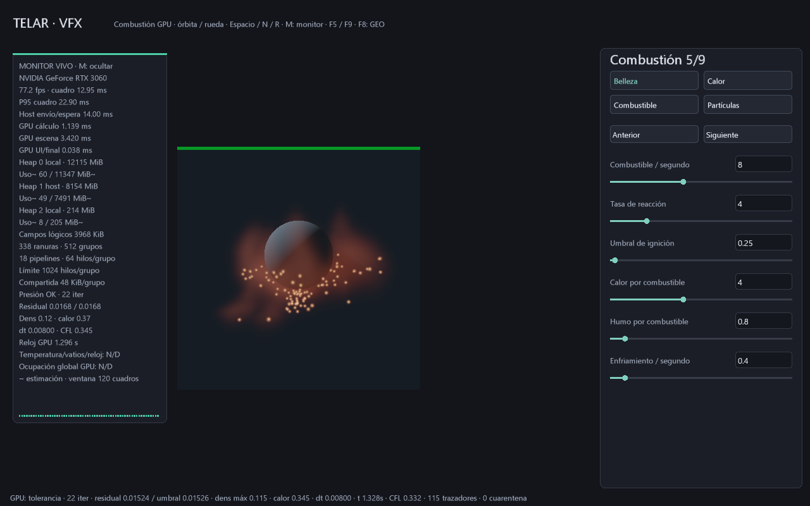

# Monitor GPU en vivo y benchmark de sesión

29-10-2026. El laboratorio VFX abre un panel vivo junto al visor. **M** lo apaga
o reactiva, incluyendo medición y copia periódica de control. `--sin-telemetria`
arranca sin observar; `--telemetria` lo habilita en los laboratorios de humo y
partículas. No se ha conectado aún al editor de objetos o al centro de categorías.

```powershell
.\target\release\telar.exe --plano-vfx --abrir-escena referencias/plano-vfx-esfera.tlar
.\target\release\telar.exe --plano-vfx --benchmark-gpu target/medicion.csv --segundos 15
.\target\release\telar.exe --humo-3d --telemetria
```

El CSV y su TXT deben ser destinos nuevos. Se escriben al cerrar; no hay E/S de
disco en cada cuadro. El CSV retiene hasta 4096 observaciones de panel y deja
celdas vacías cuando falta una medición. El TXT registra identidad/límites,
validación activa, tamaño/formato, todos los heaps consultados y control crudo.
La sesión interactiva sigue abriendo ventana; `--prueba` permite un ensayo
oculto de 120 cuadros con cambios de tamaño. Una captura también es oculta.

## Interpretación

| Dato | Origen y alcance |
|---|---|
| FPS, cuadro medio y P95 | Tiempo de pared entre cuadros dibujados; ventana móvil de hasta 120, incluye presentación/VSync y preparación |
| Host total medio | Duración de la llamada de dibujo en host, incluidas sus esperas; no porcentaje de CPU |
| GPU cálculo | Timestamp inicial hasta terminar cálculo, barreras y snapshot de control dentro del comando de dibujo |
| GPU escena | Intervalo hasta acabar el dibujo de escena, incluidas transiciones y posibles esperas de imagen |
| GPU UI/final | Overlay y finalización/transición del destino |
| Capacidad de heap | Capacidad anunciada por Vulkan, no memoria libre |
| Uso~ / presupuesto~ | Estimaciones del driver para este proceso, mediante EXT_memory_budget |
| Campos lógicos | Tamaño solicitado de buffers de campos, incluido auxiliar; excluye staging, alineación, imágenes y pipelines |
| Ranuras/grupos/pipelines | Plan preparado; una ranura puede no hacer trabajo útil cuando el shader decide omitirla |
| Presión, residual, densidad/calor | Resumen del kernel copiado a la ranura terminada |
| dt/CFL/reloj simulado | Estado temporal del solver 3D; el reloj no es frecuencia física de la GPU |

Los timestamps son intervalos de comandos en una misma cola; no son contadores
exclusivos de utilización de unidades ni un porcentaje de ocupación global.
El caso procedural que envía cómputo en un comando separado queda fuera de ese
intervalo de cálculo; esta entrega integra el monitor en los laboratorios MAC/VFX.
Los envíos del render HDR por lotes tampoco se incorporan a las muestras del
visor. El gráfico representa suma de tres intervalos GPU, escala 0..50 ms.

El [desglose host](HOST-ENVIO.md) añade medias de preparación, valla, recogida,
adquisición, grabación, envío y presentación. El CSV conserva ahora 18 columnas;
hay que leer su cabecera. Se evita reconstruir propiedades al mover la cámara.

Actualización: [reutilización compute](COMPUTE-REUTILIZABLE.md) añade tres
contadores de grabación/reuso/ruta directa; el CSV vigente tiene 21 columnas.

La semilla/escena/resolución, validación, VSync, calentamiento de pipelines y otras
aplicaciones afectan una comparación. La primera ventana de estadísticas puede
incluir compilación inicial. Para comparar, espera al menos 120 cuadros y conserva
la configuración y el TXT. Esta entrega no establece una ventaja de velocidad.

Los heaps locales pueden incluir memoria compartida o regiones con acceso BAR;
no se suman en el panel como si fueran VRAM física dedicada adicional. El CSV
guarda uso/presupuesto del primer heap local; el TXT conserva todos. El presupuesto
no promete éxito de una reserva futura y puede variar por actividad ajena.
Sin soporte de la extensión, se conserva capacidad y aparece **N/D** en uso y
presupuesto. Sin timestamps de cola, los tiempos aparecen **N/D**. Temperatura,
potencia, frecuencia y utilización global quedan **N/D**, sin estimarlos a partir
de FPS. El perfil TXT conserva límites consultados, no todas las funciones ni
todos los contadores físicos posibles de Vulkan o del fabricante.

## Sincronización y coste

Observación opcional con dos juegos de cuatro consultas y dos buffers coherentes
de lectura de 64 B. El comando copia dieciséis palabras de control tras calcular,
con barreras de transferencia/host; no cambia el buffer fuente. El presentador
recoge la ranura tras esperar su valla habitual y antes de reutilizarla. No añade
`vkDeviceWaitIdle`, envío de diagnóstico separado, ni WAIT a leer consultas por
cuadro. Las consultas llevan disponibilidad y respetan timestampValidBits al
restar, incluido el desbordamiento. La destrucción sí completa usos pendientes.

Hay copia de **64 B por cuadro observado** en humo/VFX y lectura de resultados
de cuatro timestamps (64 B incluyendo disponibilidad) por ranura terminada.
El emisor de partículas independiente no ofrece todavía un resumen de presión:
solo se recogen sus tiempos. Los buffers de lectura se reservan al activar por
primera vez: **128 B lógicos**, más consultas/alineación del driver sin medir.
Al ocultar se conservan recursos y se recogen los últimos cuadros pendientes;
dejan de grabarse marcas/copias nuevas.

Los datos GPU llegan diferidos hasta dos cuadros; el panel/driver se refrescan
a 2 Hz. La CPU mantiene ventanas móviles de 120 cuadros e historial GPU; dibuja
texto/gráfico y compone CSV en RAM. CSV acotado a 4096 filas; no registra cada
cuadro. Refrescar texto también actualiza el overlay. Observar tiene coste GPU,
CPU/RAM y ancho de banda; no se anuncia consumo cero ni ausencia de perturbación.
El semáforo refleja presión inválida/agotada y uso/presupuesto de heaps: amarillo
desde 70%, rojo desde 90% o estado numérico inválido. No es una certificación ni
alarma térmica, y no cambia los parámetros del artista automáticamente.

## Evidencia

Pruebas reales RTX 3060 / Windows 11:

- Snapshot idéntico a dieciséis palabras cargadas y campos completos sin cambios.
- Tiempos finitos, observaciones completadas y capacidades coherentes con perfil.
- Reutilización de juegos al redimensionar, apagar y volver a activar.
- Exportación CSV/TXT y rechazo de reemplazo del informe existente.
- ABI cotejado con vulkan_core.h y prueba de resta de timestamps con wrap de 8 bits.

Fuentes de prueba: `telar-app/tests/telemetria_gpu.rs`, pruebas unitarias de
`telar-gpu/src/telemetria.rs` y `ffi/memoria_viva.rs`. Comparación de sobrecoste
con/sin monitor sigue **ABIERTO**; la captura demuestra funcionamiento, no una
medición universal de rendimiento.



Referencias primarias: [presupuesto de memoria Vulkan](https://docs.vulkan.org/refpages/latest/refpages/source/VK_EXT_memory_budget.html),
[semántica de uso/presupuesto](https://docs.vulkan.org/refpages/latest/refpages/source/VkPhysicalDeviceMemoryBudgetPropertiesEXT.html)
y [consultas Vulkan](https://docs.vulkan.org/spec/latest/chapters/queries.html).
