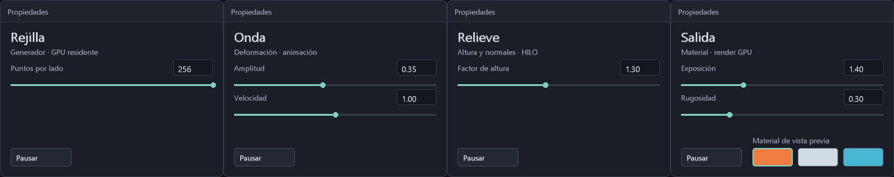

# Configuración propia de los cuatro nodos

Esta página describe el contrato histórico de cuatro etapas, conservado para v2.
El [grafo editable v3](GRAFO-EDITABLE.md) añade instancias, conexiones y edición
numérica; sus operaciones se fusionan en HILO con constantes al confirmar ediciones.
La fase común continúa viva y los parámetros del render permanecen independientes.

El inspector ya usa el estado del nodo seleccionado, no dos valores globales
con títulos distintos. Seleccionar o arrastrar una tarjeta conserva su configuración.
Tab recorre los nodos; el ratón modifica sus deslizadores. Pausa sigue siendo un
control global de la animación, también disponible con Espacio.

| Nodo | Parámetros propios | Efecto real |
|---|---|---|
| Rejilla | Puntos por lado, 2..capacidad | La GPU decide recuentos, índices y despachos dentro de los buffers existentes |
| Onda | Amplitud 0..0,8; velocidad 0..2 | Cambia deformación y avance de fase; velocidad cero conserva la fase |
| Relieve | Factor de altura 0..3 | HILO escala altura y transforma normales; cero aplana y uno conserva Onda |
| Salida | Exposición 0,25..4; rugosidad 0,08..1; tres perfiles de material; MSAA 1x/2x/4x | Modifica sombreado y cobertura sin cambiar la geometría |

El selector de calidad informa muestras solicitadas y efectivas;
[contrato y coste](CALIDAD-RENDER.md).

Los perfiles de material cargan su rugosidad inicial; después puede editarse.
La resolución máxima se fija al abrir con `--puntos`; cambiar el deslizador no
redimensiona buffers ni recompila shaders. Las tarjetas tienen estructuras propias
en `telar-ui/src/parametros.rs`; `telar-ui` sigue sin conocer Vulkan, HILO ni NUDO.

## Del inspector al cálculo

El prefijo de parámetros mantiene sus cuatro palabras: lado, fase, amplitud y
capacidad. `ParametrosNodos` añade cuatro escalares finitos en [-16,16], por un
total de **32 bytes escritos por paso**. El visor usa el primero para Relieve y
envía cero en los tres restantes. `ParametrosProcedurales` y sus métodos antiguos
siguen disponibles: los adaptadores suministran [1,3; 0; 0; 0].

HILO incorpora `Operacion::Parametro(0..3)`, lectura escalar del buffer vivo en
palabras 4..7. El índice se valida al construir el programa; el shader comprueba
la longitud antes de leer y retorna sin escribir si faltan palabras. Su referencia
CPU es `interpretar_con_parametros`. `relieve_dinamico()` se compila una vez al
preparar y recibe el factor nuevo sin recrear pipelines al mover el control.

La CPU prepara el pequeño paquete de edición y lo escribe tras la valla de su
ranura. Deformación, normales, recuentos, autosombra y sombreado ocurren en GPU.
La velocidad de animación continúa avanzando la fase en CPU; no se presenta como
un reloj autónomo del kernel.

## Invalidación y memoria

La clave exacta de caché incluye lado, fase, amplitud y los **cuatro escalares**.
Cambiar Relieve invalida toda la cadena por puntos: Onda se vuelve a evaluar desde
x/z y Relieve se aplica una vez. No se multiplica repetidamente una altura ya
escalada. La granularidad actual es la cadena completa, no una caché por operación.
Al pausar y conservar esos valores, cada ranura omite sus operaciones por puntos.
Salida cambia constantes de dibujo y no forma parte de esa clave de geometría.

El backend reserva **48 palabras / 192 bytes de control por juego**. El prefijo
ABI v1 de 32 palabras y sus offsets se conservan. Extensión: clave fase/amplitud/lado
en 32..35; válida en 35; contadores en 36/37; escalares propios en 38..42; reservados
42..48. Sin 48 palabras de control y ocho de parámetros, el coordinador ejecuta
sin caché antes de leer la extensión. La cabecera TLAR v1 declara el mínimo de
32 palabras de control y cuatro de parámetros; no es una declaración de toda la
extensión de un plan.

Respecto a la etapa anterior: parámetros +16 B y control +32 B por ranura, es
decir +96 B lógicos para los dos juegos del visor, sin otros buffers ni pipelines.
No es una medición de asignación física: alineación y tamaños reales dependen de
Vulkan. Siguen diez buffers, ocho pipelines compute, dos grabaciones y dos mapeos.

## Evidencia y límites

- **IGUAL dentro de 0,0001:** alturas y normales de Relieve dinámico frente al
  intérprete CPU, incluidos factor cero, cambios y repetición. RTX 3060 / Windows.
- La caché GPU omite valores repetidos y recalcula los nuevos; las pruebas verifican
  que los pipelines y la grabación permanecen constantes y no se sube geometría.
- Pruebas de UI verifican límites, conservación entre nodos, controles ocultos y
  cambio de selección durante un arrastre. Capturas reales a 1280×720 y 800×600.
- SPIR-V validado con la herramienta oficial, incluyendo el último parámetro (3).
- **ABIERTO:** rendimiento de grafos generales, caché por nodo, pico de VRAM y otras GPU.

La cadena anterior se conserva para escenas v2. El [grafo editable](GRAFO-EDITABLE.md)
ya crea Ondas/Relieves independientes, conecta puertos y omite operaciones; v3
guarda esa red. Los números del inspector se editan por teclado. Siguen pendientes
las tablas de atributos, vistas intermedias y geometría general con varios objetos.
