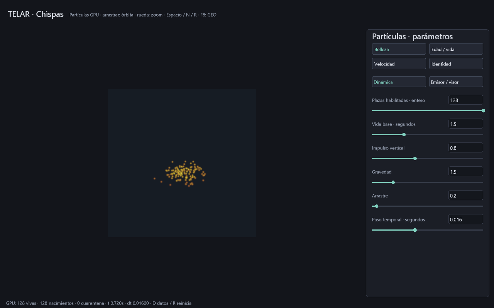

# Partículas GPU: primera base de secundarios

Entrega parcial de P5 del plan de explosión. Implementación propia en Rust/SPIR-V;
no usa Partio ni ejecuta código de Houdini. La documentación pública de
[atributos de partículas de SideFX](https://www.sidefx.com/docs/houdini/dopparticles/attributes.html)
inspira la separación entre posición, velocidad, identidad, edad y vida.
No anuncia equivalencia POP ni compatibilidad externa certificada.

## Uso y control

```powershell
cargo build -p telar-app --release
.\target\release\telar.exe --particulas
.\target\release\telar.exe --particulas --pasos 45 --exportar-geo target/chispas.geo
.\target\release\telar.exe --inspeccionar-geo target/chispas.geo
```

También abre **TELAR Particulas.cmd** o la tarjeta Partículas GPU de Simulación.
Dos páginas exponen diez parámetros; clic en número y **Enter** aplica, Esc cancela.
Vistas: Belleza, Edad/vida, Velocidad e Identidad. Arrastrar orbita; rueda acerca.
Espacio pausa, N avanza un paso, R borra estado/reloj, D descarga diagnóstico,
F5 guarda configuración, F9 abre y reinicia, F8 exporta las partículas vivas.
Los archivos GEO deben ser nuevos; no se sobrescriben.

| Parámetro | Dominio | Valor inicial |
|---|---|---|
| Plazas habilitadas | Entero 1..128 | 128 |
| Vida base | 0.1..5 s | 1.5 |
| Impulso vertical | 0.05..2 unidades/s | 0.8 |
| Gravedad | 0..8 unidades/s² | 1.5 |
| Arrastre | 0..5 s⁻¹ | 0.2 |
| Paso temporal | 0.001..0.04 s por cuadro | 0.016 |
| Radio visual | 0.002..0.03 unidades | 0.012 |
| Semilla | Entero 0..65535 | 7 |
| Duración de fuente | 0..2 s; cero continuo | 0 |
| Dispersión lateral | 0..1 | 0.6 |

Cambiar vida/semilla afecta a futuros nacimientos. Reducir plazas desactiva las
superiores. Cambiar duración no reinicia el reloj: R vuelve a comenzar.
El tiempo es simulado por cuadro presentado, no un reloj de pared ni dt adaptativo.

## Estado y matemática

Capacidad fija de 128 plazas, dominio unitario Y arriba, fuente en (0.5,0.18,0.5).
Doce planos SoA f32: posición XYZ, velocidad XYZ, edad, vida asignada, generación,
nacimiento, estado y control. Estado: 0 inactiva, 1 viva, -1 cuarentena.
Dos programas por paso: actualización propietaria por plaza y resumen serial
GPU de 128 plazas. El host envía este plan fijo y constantes; no decide nacimientos,
muertes ni reciclaje. Vulkan, eventos, cámara, archivos y presentación siguen
necesitando CPU/controlador. Esto no convierte la GPU en un SO autónomo.

Primeros nacimientos escalonados durante duración positiva, o 0.5 s si continuo.
El nacimiento integra solo el solapamiento de dt. Generación incrementa al nacer;
`id = generación*128 + plaza` conserva identidad durante una vida y cambia al
reciclar. Generación máxima 65535: esa plaza deja de renacer antes de repetir ids.
Máximo id 8388607, representable exactamente como f32. R abre una nueva ejecución.
Semilla y generación alimentan un LCG u32 propio con aritmética modular; vida y
velocidad inicial varían. No se afirma igualdad bit a bit entre fabricantes.

Euler semiimplícito: vy -= gravedad*dt; v *= max(1-arrastre*dt,0); P += v*dt.
Suelo y=0: clamp y rebote vertical 0.4. Salir de X/Z [0,1] o Y>1 mata la plaza.
Edad alcanza vida: muere; puede renacer al cuadro siguiente si la fuente continúa.
No hay detección continua, colisiones entre partículas, mallas ni subpasos.
Reloj máximo 3600 s; último dt se recorta y después congela el estado físico.
Valores no finitos/extremos y banderas/generaciones inválidas pasan a cuarentena;
R limpia. No es un sanitizador general de cualquier corrupción de memoria.
El resumen cuenta vivas, suma generaciones de plazas no aisladas, cuarentenas,
máximo L1 de velocidad, plazas habilitadas, dt efectivo y límite temporal.

## Visor, intercambio y costes

Splat gaussiano aditivo por partícula en un fragment shader, con desvanecimiento
por edad. Cuatro vistas usan el mismo estado. Radio es solo visual. No hay
oclusión, profundidad, sombras, estelas ni iluminación volumétrica. El coste es
O(píxeles*128); el visor se limita a 384². No es un render de producción.

Estado lógico compartido: **6148 B** (128*12*4 + 4 del backend), sin contar
alineación, imágenes, interfaz ni controlador. Dos despachos por paso; no usa
atómicos float. Simulación sin descargas por cuadro estable. D descarga 32 B;
F8 descarga **5664 B** (32 de control + 11*128*4), valida y serializa en CPU.
No se han medido FPS, tiempos GPU ni pico físico VRAM/RAM.

GEO clásico V5, perfil fijo de ocho atributos: v, density, heat, id, sim_time,
age, life, birth_time; P implícita. Solo plazas vivas, en orden de plaza.
density=1; heat=clamp(1-age/life) es una máscara visual, no temperatura.
Particula ocupa 52 B host; validación reserva además puntos/ids temporales y texto.
El formato limita 65536 puntos/16 MiB. `.tlar` v12 guarda 56 B de configuración,
no posiciones/reloj ni caché reanudable. Ver [contrato GEO](INTERCAMBIO-GEO.md).

## Evidencia y límites

RTX 3060 / Windows, 28-10-2026: ejecución nativa de 45 pasos produjo 128 vivas,
128 nacimientos, cero cuarentena, t=0.7199997 s y dt=0.016. Exportación e inspección
mostraron age máximo 0.7199997 y life máximo 1.865238. Cero avisos Vulkan del
producto. Reapertura de v12, 120 cuadros y dos redimensionados también terminaron
sin avisos; el inspector reconoció v12 sin iniciar Vulkan. Los dos perfiles GEO
propios se inspeccionaron por separado. `cargo verify` pasó guardián, formato,
clippy pedantic y toda la suite. Captura real del programa, sin fabricar partículas:



`particulas_gpu.rs` valida SPIR-V, compara todos los planos contra referencia
escalar (tolerancia absoluta 0.0002) en pulso de 160 y continuo de 120 pasos,
reciclaje, cambio de semilla/cantidad, suelo, cuarentena, reinicio, límites,
pausa/cámara/cuatro vistas sin mutar física y exportación sin sobrescribir.
Pruebas UI cubren edición/Enter y rechazo transaccional; GEO prueba ambos perfiles,
vida válida, tipos, aridad, truncamiento y nube vacía; v12 verifica CRC.
Referencia CPU solo para ensayos, no para simular el producto.

Comparación Houdini/Partio: **ABIERTO**; solo hay roundtrip propio.
P5 sigue parcial: falta emitir desde humo/combustión, acoplar partículas inerciales al gas,
estelas, fragmentos, fuentes dirigibles y presupuesto escalable. El primer transporte pasivo por campo MAC ya tiene una entrega separada en
[TRAZADORES-MAC.md](TRAZADORES-MAC.md), sin fusionar los controles de este emisor.
