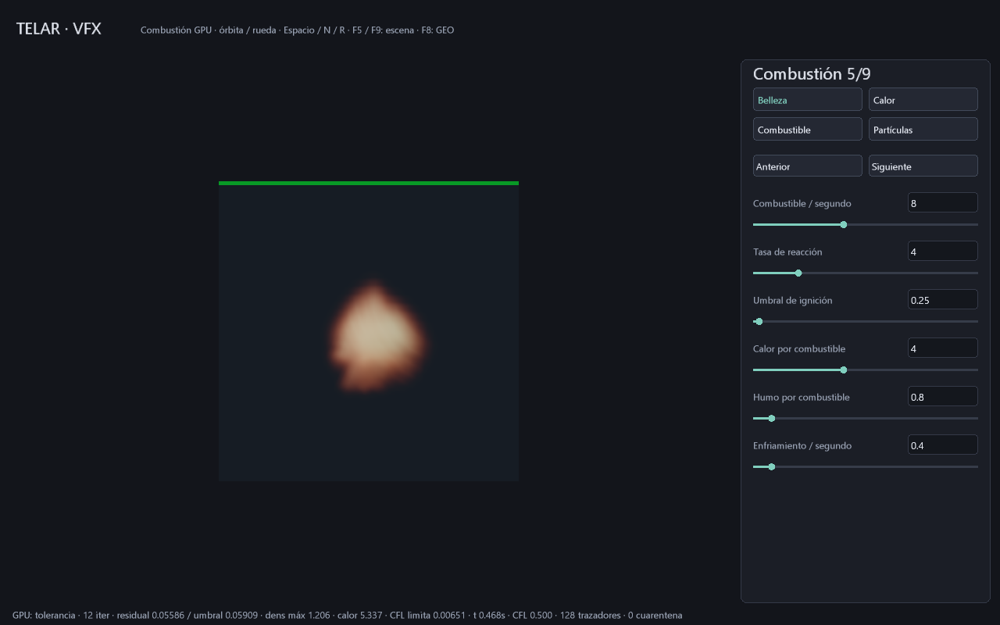
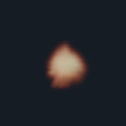
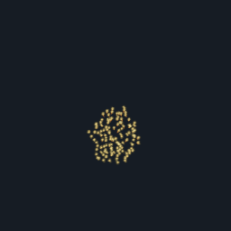

# Plano VFX: primera cadena reactiva residente

Entrega del 29-10-2026. Combina campos MAC, combustible, reacción, partículas,
iluminación volumétrica y salida HDR. Es un prototipo integrado a 32³; la
comparación con Pyro/Houdini y el acabado cinematográfico siguen **ABIERTO**.
No implementa RenderMan ni ejecuta VEX/.hip.

## Abrir y dirigir

```powershell
cargo build -p telar-app --release
.\target\release\telar.exe --plano-vfx
```

También existe **TELAR Plano VFX.cmd**. Nueve páginas separan simulación,
presión, tiempo/colisión, pulso, reacción, partículas, luz, aspecto/fuente y
detalle. Hay 28 parámetros adicionales: combustible, umbral/tasa de reacción,
rendimientos, enfriamiento, vida/cantidad/semilla, acoplamiento al gas,
gravedad, luz, absorción, albedo, emisión, anisotropía, posición de fuente,
umbral de nacimiento, detalle y estelas. Los números se confirman con Enter;
cantidad 1..128 y semilla 0..65535 son enteros.

Órbita con arrastre, zoom con rueda; Espacio pausa, N avanza y R reinicia.
F5/F9 guarda/abre parámetros .tlar v13, reiniciando los campos al abrir.
F8 exporta partículas vivas GEO; D solicita diagnóstico. Las vistas son
Belleza, Calor, Combustible y Partículas. Calor, Combustible y Partículas son
diagnósticos. Belleza integra ahora chispas y estelas atenuadas por el humo;
Partículas permite inspeccionarlas sin esa atenuación.

## Render y reanudación

Los destinos deben ser nuevos; no se reemplazan resultados anteriores.

```powershell
# Simular 36 cuadros y producir una imagen lineal y una revisión sRGB.
.\target\release\telar.exe --plano-vfx --pasos 36 --render-vfx target/prueba.pfm --spp 16 --pases-vfx --guardar-cache target/prueba.tlcache

# Dos fotogramas, separados por 18 avances, con los cuatro pases.
.\target\release\telar.exe --plano-vfx --secuencia-vfx target/secuencia-nueva --fotogramas 2 --intervalo 18 --spp 4 --pases-vfx

# Abrir el estado exacto o continuar otros 18 cuadros y guardarlo.
.\target\release\telar.exe --abrir-cache target/prueba.tlcache
.\target\release\telar.exe --abrir-cache target/prueba.tlcache --pasos 18 --guardar-cache target/continuacion.tlcache
```

El render final es de 256², 1..1024 spp, 64 segmentos primarios y ocho muestras
de sombra por segmento. GPU calcula media RGB lineal y revisión Reinhard/sRGB.
Más spp reduce error de muestreo espacial; no añade resolución a los campos
ni elimina errores del modelo. La simulación queda congelada durante el render.
PFM conserva valores lineales sin exposición; PPM usa la exposición del editor.
TXT acompaña receta, tiempo simulado y límites. La secuencia incluye escena y
manifiesto, hasta 1000 cuadros y 2000 avances totales. Son avances del solver:
el reloj GPU puede reducir dt por CFL, no se promete una cadencia de cine fija.
La salida por lotes es síncrona en una ventana oculta; no añade trabajador
asíncrono al editor VFX. Si falla un cuadro posterior, se conservan los anteriores.

.tlcache revisión 2 guarda campos exactos, cámara, parámetros y contador de
avances. Tiene CRC de cabecera/cuerpo, máximo 16 MiB y comprueba GPU, driver y
versión Vulkan antes de cargar. La publicación usa temporal sincronizado y
enlace exclusivo en el mismo sistema de archivos: requiere soporte de enlaces
duros. No se promete persistencia ante corte eléctrico ni portabilidad entre
drivers. .tlar guarda parámetros; .tlcache guarda además la simulación.

## Modelo y límites físicos

El combustible se transporta por la velocidad MAC. Reacción local:
`quemado = min(combustible, tasa * dt * max(calor - umbral, 0))`.
Produce calor y humo, aplica enfriamiento y pérdida de combustible. Los campos
son normalizados: calor no es Kelvin. No hay oxígeno ni cinética química; la
expansión sigue siendo el pulso compensado del laboratorio, independiente del
combustible consumido. Dos armónicos analíticos aportan detalle antes de
proyectar presión; no equivalen a confinamiento de vorticidad.

Hasta 128 secundarios nacen según umbral de calor, siguen velocidad del gas
con respuesta exponencial y gravedad, guardan edad/vida/identidad e historial
de cuatro posiciones. Semilla permuta una retícula fija de nacimiento; no es
un emisor aleatorio continuo. El acoplamiento es unidireccional. Faltan
fragmentos, detección continua de colisión y estelas volumétricas físicas.
La [composición de secundarios](VFX-COMPUESTO.md) añade transmisión aproximada
hacia cada punto/segmento; no ilumina el gas desde las chispas.

Render integra Beer–Lambert, emisión artística, una luz puntual con sombra y
dispersión simple Henyey–Greenstein. La esfera de colisión ya se representa
como superficie opaca analítica y bloquea luz/secundarios; ver
[esfera y volumen](VFX-ESFERA.md). El solver conserva su máscara voxelizada.
Faltan dispersión múltiple, luces de área, temperatura espectral calibrada,
integración con geometría general y gestión de color de producción.

## Costes y evidencia

CPU prepara SPIR-V, interfaz, constantes, envíos, esperas y archivos. GPU
transporta/reacciona/proyecta, decide dt/estado de presión, actualiza secundarios
y calcula los píxeles. No hay lecturas de campos por cuadro estable; editar
parámetros VFX sube 112 B. El host sigue enviando trabajo Vulkan: no hay
autonomía de dispositivo fuera de ese contrato.

Reserva lógica compartida a 32³: 31 planos de 32768 palabras más cuatro bytes
del backend = **4 063 236 B**. Incluye campos, cola y salida final; no representa
VRAM física total: staging, alineación, imágenes y pipelines añaden coste.
Render descarga 1 310 720 B; caché copia 1 015 808 palabras y ocupa 4 063 512 B
incluyendo cabecera/escena/cámara. RAM crece con copias y serialización explícitas.
Cada muestra final usa un envío acotado. No se ha medido tiempo GPU ni ventaja
de velocidad; no se declara MÁS RÁPIDO ni consumo cero.

En RTX 3060 / Windows 11 se comprobaron:

- Reacción uniforme contra resultado escalar, ignición y combustible agotado.
- Cantidad/vida/semilla, desplazamiento de fuente e historial de secundarios.
- Transmisión Beer–Lambert, respuesta a absorción/luz y contador progresivo;
  el render no modifica la simulación.
- Validación SPIR-V y ejecución Vulkan con validación de sincronización.
- Reanudación MAC 18+18 frente a 36 avances: **IGUAL**, caché completa.
- Reanudación reactiva 8+8 frente a 16: **IGUAL**, caché completa y PFM a 2 spp.
- Secuencia de dos cuadros por cuatro pases a 4 spp; reapertura v13 y 120
  fotogramas con dos cambios de tamaño, cero avisos contabilizados de validación.

Las pruebas son `telar-app/tests/vfx_gpu.rs`, `cache_reanudable.rs` y
`telar-ui/tests/humo.rs`. Las capturas son salida GPU real, sin retoque:





## Siguiente trabajo de producción

P3–P6 avanzan parcialmente; P7 sigue abierto. Prioridad: medir tiempos GPU,
resolver errores a mayor resolución, regiones activas y colisiones generales;
después integrar superficies generales y emisión de secundarios que ilumine
el volumen. El flujo
artístico necesita grafo VFX editable, atributos, curvas, deshacer y proyecto
unificado. EXR/OpenVDB, gestión de color, reanudación portátil y validación
externa quedan pendientes. No basta elevar spp para cerrar estos hitos.

Referencias públicas estudiadas: [campos Pyro](https://www.sidefx.com/docs/houdini/pyro/background),
[combustión](https://www.sidefx.com/docs/houdini/nodes/dop/gascombustion.html),
[llamas](https://www.sidefx.com/docs/houdini/pyro/flames.html),
[transmisión PBRT](https://www.pbr-book.org/4ed/Volume_Scattering/Transmittance)
y [dispersión PBRT](https://www.pbr-book.org/4ed/Volume_Scattering).
TELAR implementa un modelo propio; no reproduce el solver propietario ni
presupone equivalencia con el modelo moderno de llama de SideFX.
