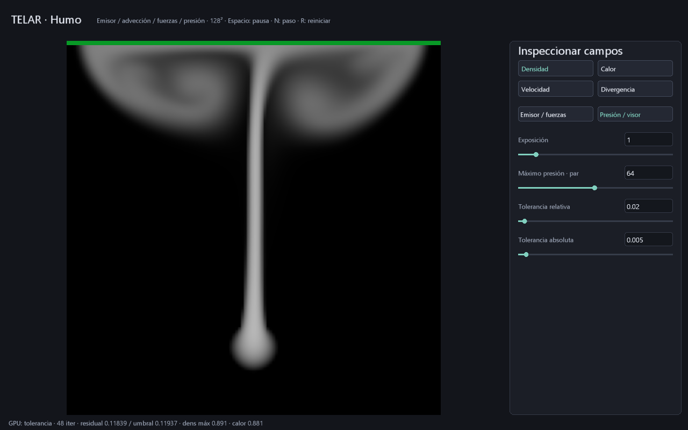

# Presión: criterio de parada decidido en GPU

El laboratorio `--humo` usa ahora un control de error global. La GPU conserva
la estimación de presión entre pasos, mide su residual y deja de actualizarla
cuando alcanza el criterio o agota el presupuesto. La CPU no lee el residual
para decidir cada iteración. No se ha medido una mejora de velocidad frente
al modo fijo ni frente a CPU/Houdini.

## Controles para el artista

En **Presión / visor** se pueden editar:

- Exposición: afecta a la vista.
- Máximo de presión: par entre 2 y 128; es un presupuesto, no calidad garantizada.
- Tolerancia relativa: 0..0,5, predeterminada 0,02.
- Tolerancia absoluta: 0..0,1, predeterminada 0,005.

Enter aplica y Escape cancela. Cambiar estos parámetros conserva los campos.
La franja superior del visor se colorea **directamente leyendo el estado GPU**:
verde si alcanzó la tolerancia, amarillo si agotó el presupuesto, rojo si se
detectaron datos inválidos y azul si todavía no hay un paso calculado.
Verde certifica ese criterio numérico acotado, no calidad cinematográfica.

**D** descarga un resumen de **64 bytes**, no toda la rejilla. Muestra motivo
de parada, iteraciones efectivas, residual máximo, umbral y máximos de densidad
y calor. Es una instantánea solicitada, no telemetría continua. Todavía espera
la operación de descarga y no mide tiempo GPU.

## Qué se calcula

Para el potencial `q` del solver MAC se mide:

`r = div(u_provisional) - L(q)`

Se acepta `max(abs(r)) <= max(atol, rtol * max(abs(div(u_provisional))))`.
Se comprueba la estimación inicial y después de cada **par** Jacobi amortiguado.
La norma es **L∞**, distinta del RMS usado en el diagnóstico inicial de humo.
El gradiente aplicado después puede introducir pequeñas diferencias de redondeo
en la divergencia final; no se promete igualdad exacta de ambos cálculos f32.

Las tolerancias absoluta/relativa y un límite independiente de iteraciones son
un patrón habitual de solvers iterativos; [PETSc documenta ese tipo de criterio](https://petsc.org/release/manualpages/KSP/KSPConvergedDefault/).
TELAR usa su propia implementación y norma máxima, sin enlazar PETSc.

Cada celda escribe su residual. Una pasada calcula máximos en bloques de 64
celdas; una invocación combina esos parciales en orden fijo y publica estado,
contador y umbral. No hay sumas flotantes atómicas ni espera activa entre grupos.
Las pasadas restantes consultan la bandera de actividad y omiten su trabajo.
Los no finitos o magnitudes mayores de 1e20 se convierten en una señal inválida;
en ese caso no se aplica la proyección al estado físico. R reinicializa los campos.

## Coste real y límites

La CPU **sigue enviando un plan acotado completo**. Aún se lanzan los despachos
previstos y sus barreras aunque la presión termine antes. No es despacho
indirecto adaptativo ni se garantiza menor tiempo de fotograma: hay más pasadas
de reducción y comprobación. Con máximo 64 son 167 huecos de despacho; con 128,
327. El backend permite hasta 512; siguen siendo 14 programas únicos.

El estado ocupa quince planos f32: los doce anteriores, residual, parciales y
control. Reserva lógica: `60*N²+4` bytes; **983044 B a 128²**, más destinos,
atlas, pipelines, alineación y UI. La cabecera de control usa solo las primeras
palabras de su plano; el resto de ese plano queda reservado. El bucle normal
no descarga campos. Las pruebas pueden descargar el estado completo.

La configuración se guarda como **.tlar v8**, 56 B, diez f32 y CRC del payload.
Se siguen leyendo escenas v7 de ocho parámetros, añadiendo las tolerancias
predeterminadas. Guardar configura el solver; no guarda una caché de simulación.

## Evidencia

`humo_adaptativo_gpu.rs` verifica en Vulkan y con `spirv-val`:

- Campo vacío: convergencia sin iteraciones Jacobi.
- Caso no trivial: finaliza tras cuatro de ocho iteraciones previstas y coincide
  con la referencia escalar ejecutada cuatro veces, error absoluto <0,0003.
- Tolerancia relativa y residual global, incluido el último bloque parcial de 17².
- Presupuesto agotado sin presentarlo como convergencia; los huecos posteriores
  no siguen modificando el resultado.
- NaN inyectado: estado inválido y proyección omitida; franja roja real.
- Franjas verde/amarilla, repetibilidad y descarga de un rango de 64 B.

En la captura reproducible a 128², después de 240 pasos con valores por defecto,
la RTX 3060 informó **48 iteraciones**, residual máximo **0,11839** y umbral
**0,11937**: tolerancia alcanzada. Es evidencia de esa escena, no un benchmark
ni una garantía para cualquier configuración.

```powershell
cargo run -p telar-app --example capturar_presion --release -- target/presion.ppm
```



Sigue pendiente un solucionador más eficaz, eliminación de despachos sobrantes,
subpasos temporales, humo 3D, combustión y acoplamiento al render volumétrico.
