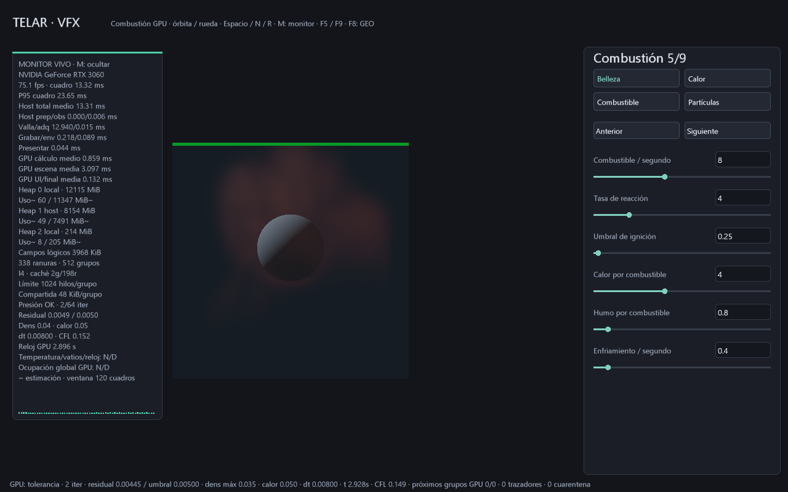

# La GPU decide los grupos de presión que se lanzan

29-10-2026. El solver publica argumentos `VkDispatchIndirectCommand` y el plan
reutilizable los consume en GPU. Al converger o agotar presupuesto, los
argumentos pasan a cero grupos para las pasadas pesadas siguientes. La CPU
no lee el residual para decidir estos despachos.

```powershell
.\target\release\telar.exe --plano-vfx --abrir-escena referencias/plano-vfx-esfera.tlar
# Misma matemática y dominios estáticos; argumentos directos para comparar.
.\target\release\telar.exe --plano-vfx --sin-indirectos --benchmark-gpu target/directa-nueva.csv --segundos 15
```

Se habilita en los laboratorios MAC 2D/3D, explosión y VFX. El emisor de
partículas independiente conserva despachos directos. `--sin-cache-compute`
controla reutilización host y `--sin-indirectos` controla argumentos GPU: son
opciones separadas. El monitor muestra **I4**, cuatro programas con ruta
indirecta, no cuatro grupos ejecutados. D en 3D consulta los próximos grupos.

## Protocolo y sincronización

El auxiliar reservado crece de 4 a **64 B** en binding 0; binding 1 conserva
exactamente los campos físicos. Dos comandos u32 x/y/z ocupan seis palabras:
uno para Jacobi A/B y residual, otro para reducción parcial. El único escritor
es la invocación que decide convergencia.

Si `G = ceil(celdas/64)`, los comandos activos son `(G,1,1)` y
`(ceil(G/64),1,1)`. Al cerrar presión pasan a `(0,1,1)`. Los enteros se guardan
como u32, separados de floats físicos. Las resoluciones admitidas acotan los
grupos dentro del perfil Vulkan usado por TELAR.

Programas 9/10/11 comparten el primer comando y 12 consume el segundo. Los
decisores 8/13 son directos, con un grupo, y publican argumentos. Las reducciones
iniciales y CFL usan su dominio estático necesario, también con
`--sin-indirectos`. La comparación no sobredimensiona artificialmente la ruta directa.

El backend distingue rutas directas, indirectas y productores. Se publican
argumentos una vez por productor hacia `DRAW_INDIRECT/INDIRECT_COMMAND_READ`;
los consumidores intermedios no los modifican. Antes de escribir se ordenan
lecturas indirectas previas. La primera pasada enlaza con el envío anterior.
Publicar en cada pasada añadía coste; se delimita a productor/consumidor.

Auxiliar y campos están separados: Jacobi escribe presión sin pisar sus propios
parámetros de lanzamiento. Limpiar inicializa ambos a cero. La descarga de
argumentos es explícita, no decide grupos. Cambiar rutas aumenta la versión
del plan e invalida sus secundarios por juego; conserva la sincronización por valla.

Se validan programas, duplicados, alineación, rango y grupos directos. El
productor garantiza límites de los counts GPU; no se descargan para autorizarlos.
Se exige un productor declarado y ejecutarlo antes del primer consumidor.

## Costes y límites

La CPU conserva plan, parámetros, envío y observación. La GPU publica dos
comandos por decisión y los lee con barreras adicionales. Menos grupos no
garantiza menos tiempo en toda GPU/escena, especialmente al usar todo el
presupuesto. Existe fallback directo; las mediciones solo cubren la referencia.

El plan mantiene sus ranuras: cero grupos evita invocaciones, pero no elimina
el comando ni toda su gestión en dispositivo. El decisor pequeño aún comprueba
estado al final de cada par. No es compactación espacial ni un solver sparse.

Reserva adicional: **60 B lógicos por estado de campos**. VFX 32³ pasa a
**4 063 296 B** para campos/auxiliar, más imágenes, staging, comandos, queries,
alineación y memoria del driver sin pico físico medido. El monitor conserva
64 B de control y timestamps por ranura; no añade descarga por cuadro.
D/captura 3D añade una consulta explícita de 64 B: con trazadores son 640 B
de diagnóstico. GEO conserva su ruta anterior.

El auxiliar transitorio no se serializa. El nuevo ABI usa **.tlcache revisión 3**;
se rechazan las antiguas con explicación y no se sobrescriben. Para ellas se
necesita la versión que las creó o reabrir su configuración .tlar. Las escenas
.tlar v13 no cambian. El primer decisor reconstruye argumentos al reanudar.

Los tiempos GPU del monitor/CSV pasan a medias móviles de hasta 120 muestras
terminadas, todavía diferidas hasta dos cuadros. El historial sigue mostrando
muestras individuales. Archivos históricos conservan su semántica anterior
de última muestra: comparar rutas con el mismo binario.

## Verificación y medida

**IGUAL**, RTX 3060 / Windows 11: cada palabra física tras seis pasos MAC con
velocidad inicial perturbada frente a despacho directo. Se observan counts
activos `(8,1,1)/(1,1,1)` a 8³ y después cero X al cerrar el presupuesto.
Reejecutar ranuras cerradas no altera campos. Limpiar pone el auxiliar a cero.
Las rutas inválidas se rechazan sin aplicar cambios parciales.

**IGUAL**, misma máquina: caché VFX completa, PFM y PPM a 36 avances / 2 spp,
con/sin indirectos y con/sin secundarios cacheados. Pruebas: `indirectos_gpu.rs`,
`cache_compute.rs`, `vfx_gpu.rs`, `telemetria_gpu.rs` y `cache_reanudable.rs`.
Se mantienen validación SPIR-V, sincronización Vulkan, pausa, resize y reanudación.

### MÁS RÁPIDO en el intervalo de cálculo de esta escena

Release, RTX 3060, escena de esfera, MAC 32³, visor 384², presupuesto 64,
dos subpasos, validación activa y `VK_LAYER_VALIDATE_SYNC=1`. Tres ejecuciones
por ruta, orden I/D, D/I, I/D; 200 avances cada una, última ventana de hasta
120 muestras. Sin pruebas GPU TELAR en paralelo; no se controlaron todos los
procesos externos. No es garantía de rendimiento para otras cargas o tarjetas.

| Cálculo GPU | Directo | Indirecto |
|---|---:|---:|
| Mediana de tres ventanas | 0.987 ms | 0.854 ms |
| Rango observado | 0.980..1.024 ms | 0.771..0.859 ms |

Aproximadamente 14% menos en ese intervalo, que incluye otras pasadas de
simulación y observación. No es 14% más FPS ni 14% menos render completo.
La escena gráfica siguió cerca de 3 ms y la cadencia cerca de 75 fps con FIFO.
La grabación host permaneció alrededor de 0.21 ms; se conserva la caché de comandos.

Datos: [I1](capturas/presion-indirecta-1.csv), [I2](capturas/presion-indirecta-2.csv),
[I3](capturas/presion-indirecta-3.csv), [D1](capturas/presion-directa-1.csv),
[D2](capturas/presion-directa-2.csv), [D3](capturas/presion-directa-3.csv).
Cada CSV tiene TXT del mismo nombre con perfil y parámetros.



Sigue pendiente compactar regiones activas y comparar coste por densidad de
trabajo antes de subir resolución. Presión no se puede recortar únicamente
donde se ve humo: sus dependencias atraviesan el dominio.

Referencias primarias: [compute desde buffer](https://docs.vulkan.org/guide/latest/compute_shaders.html),
[counts y límites](https://docs.vulkan.org/spec/latest/chapters/dispatch.html),
[sincronización](https://docs.vulkan.org/guide/latest/synchronization_examples.html)
y [validación](https://github.com/KhronosGroup/Vulkan-ValidationLayers/blob/main/docs/updating_from_VK_EXT_validation_features.md).
