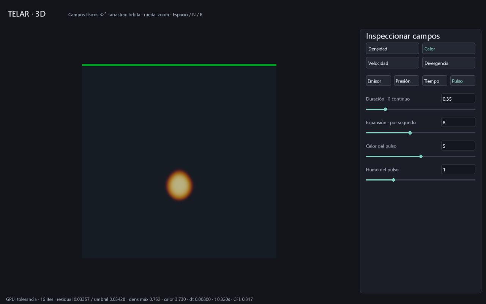
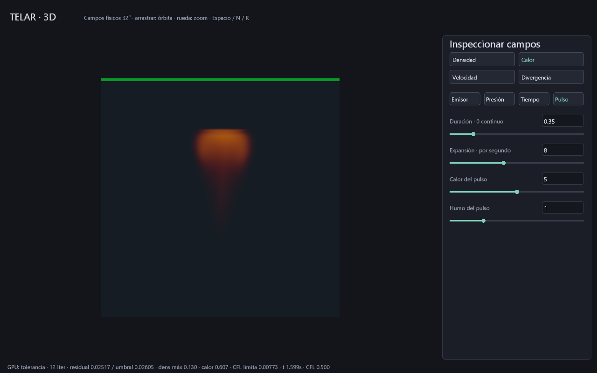

# Primera fuente expansiva de duración finita

TELAR añade un pulso de calor/humo con **divergencia objetivo compensada**,
resuelto en GPU sobre el volumen MAC 32³. Es una primera pieza de P3; todavía
no hay combustible, reacción química, choque compresible ni explosión de producción.

```powershell
cargo build -p telar-app --release
.\target\release\telar.exe --explosion
# También: TELAR Explosion 3D.cmd
```

El modo usa el laboratorio 3D existente, inicia la vista Calor y abre la pestaña
**Pulso**. El preset tiene duración 0.35 s, expansión 8/s, calor ×5, humo ×1,
radio emisor 0.13 y obstáculo desactivado. `--humo-3d` conserva emisión continua.
F5/F9 guarda/abre configuración; Espacio pausa, N avanza, R reinicia campos/reloj
y D obtiene 64 B de resumen. El reloj es de simulación, no tiempo de pared.

| Parámetro de Pulso | Dominio | Efecto |
|---|---|---|
| Duración | 0..2 s | 0 conserva fuente continua; positiva termina la inyección |
| Expansión | 0..20/s | Amplitud de divergencia objetivo durante el pulso |
| Calor | 0..10 | Multiplicador de la fuente térmica del pulso |
| Humo | 0..4 | Multiplicador de la fuente de densidad del pulso |

Se aplican con Enter o deslizador. Con duración cero los otros tres valores de
Pulso no modifican la fuente continua histórica. El tiempo parte de R/arranque,
no de la edición del campo: cambiar duración con el reloj ya avanzado no reinicia
el efecto. La tasa global y el radio están en Emisor; exposición/error en Presión;
subpasos/CFL/esfera en Tiempo. Las fuentes siguen centradas en la parte baja del
dominio. Posición, dirección y envolventes arbitrarias están pendientes.

## Emisión exacta en el final del intervalo

Antes del subpaso se congela el reloj en el control GPU. Para duración `d`, inicio
`t` y paso efectivo `dt`, el peso es:

```text
pulso = min(max(d-t, 0), dt) / dt
aporte = tasa * dt * máscara * pulso * multiplicador
```

Si dt=0 se usa peso cero; el divisor está protegido. Un subpaso que cruza el final
solo emite durante su solapamiento. Después no inyecta más; los campos existentes
continúan transportándose, disipándose y flotando. El calor sigue siendo normalizado,
no kelvin ni energía física. Los escalares se acotan a 0..10; su disipación térmica actual es 0.2/s por Euler explícito.
La paleta de calor rojo/amarillo/blanco es artística, no radiancia de cuerpo negro.

## Expansión compatible con paredes cerradas

En una caja sin flujo exterior, la integral de divergencia debe ser cero. Pedir
expansión positiva aislada haría incompatible el problema Neumann. TELAR reduce
en GPU la suma de la máscara de fuente y la cantidad de celdas fluidas y calcula
su media espacial. La divergencia objetivo por celda fluida es:

```text
objetivo = expansión * pulso * (máscara - media_máscara)
RHS_presión = div(velocidad_provisional) - objetivo
error_final = div(velocidad_proyectada) - objetivo
```

La región fuente se expande y el resto recibe una compensación distribuida.
Las celdas sólidas tienen objetivo cero y las caras cerradas permanecen cerradas.
El residual usa ese mismo RHS; el visor Divergencia muestra **error respecto al
objetivo**, que coincide con divergencia ordinaria cuando el pulso está apagado.
No se está resolviendo una onda de choque ni un gas compresible con ecuación
de estado. La compensación global presupone una región fluida conectada, como
el dominio y la esfera estática actuales; colisionadores que separen cámaras
necesitarán compensación por componente.

El predictor CFL existente mide las velocidades antes del subpaso e incluye
flotación/viento. No anticipa de forma garantizada la proyección con expansión.
Se vuelve a medir en el siguiente subpaso; no se anuncia estabilidad universal.
La presión sigue acotada y puede agotar presupuesto sin converger; su franja
y resumen permiten distinguirlo.

## ABI, memoria y archivos

Se mantienen diecisiete planos, dieciséis programas y el mismo número de posiciones
de despacho. Los parciales temporales pasan de cuatro a seis palabras por grupo
de 64 celdas: máximos u/v/w/calor, suma de máscara y cuenta fluida. Cabe en el
plano existente incluso a 4³; los parciales de presión siguen usando cuatro.
Las barreras separan sus usos. No se añaden atómicos ni lecturas de campos por
cuadro para decisiones de simulación.

El control añade `[15]=media_máscara`, `[16]=inicio_congelado_del_subpaso`.
El reloj acumulado `[13]` se actualiza después del diagnóstico, evitando que una
invocación cambie la fuente mientras otras todavía la evalúan. D descarga solo
las palabras 0..15; el ensayo completo puede leer el estado.

Constantes nuevas: `[8]=duración`, `[23]=expansión`, `[27]=calor`, `[31]=humo`.
La reserva lógica sigue siendo **2 228 228 B a 32³** más gráficos, alineación,
pipelines y staging. La reducción espacial y evaluación de fuente añaden trabajo
GPU; el pico físico y los FPS no se han medido.

`.tlar` **v11 de 88 B** guarda diez parámetros de humo, cuatro de tiempo/esfera
y cuatro de pulso, con CRC y validación de dominios. V9/v10 migran con pulso
desactivado. No guarda campos, reloj, cámara ni una caché de simulación.

```powershell
.\target\release\telar.exe --explosion --guardar-escena explosion.tlar
.\target\release\telar.exe --explosion --abrir-escena explosion.tlar
.\target\release\telar.exe --explosion --pasos 20 --captura-humo target/pulso.ppm
```

## Evidencia y límites de producción

`tests/volumen_gpu.rs` compara 14 planos con referencia escalar a 9³ antes del
final, cruzándolo y después; con/sin esfera. Verifica balance global del RHS
(suma absoluta <0.0001), error por valor <0.0003, reloj, repetibilidad y ausencia
de nueva emisión después de terminar. También valida los dieciséis shaders
con spirv-val y mantiene los ensayos anteriores. La UI prueba Enter/decimales y
rechazo transaccional; el formato prueba CRC y migración v9/v10.

Capturas reales, RTX 3060 / Windows 11, preset inicial:

| Cuadros | Tiempo GPU | dt final | Residual / umbral | Calor máximo |
|---|---|---|---|---|
| 20 | 0.320 s | 0.008 s | 0.03357 / 0.03428 | 3.730 |
| 100 | 1.599 s | 0.00773 s | 0.02517 / 0.02605 | 0.607 |

Ambas ejecuciones terminaron sin avisos Vulkan del producto. Reabrir v11 y migrar
v10 con 120 cuadros y redimensionado también terminó sin avisos. `cargo verify`
comprueba el conjunto del workspace. Las capturas no son un benchmark
ni una comparación contra Houdini. El resultado es deliberadamente simple y
difusivo a 32³; faltan combustible/reacción, detalle turbulento, fuentes dirigibles,
iluminación volumétrica, secundarios, cachés y secuencias HDR.
Ver el [plan de producción](PLAN-EXPLOSION-PRODUCCION.md).




