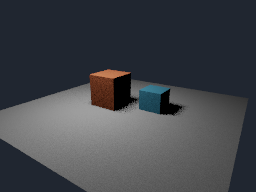

# Render directo con varios objetos y controles numéricos

Entrega experimental del **28 de octubre de 2026**. `--render-rayos` calcula
una imagen en GPU con suelo y dos cajas independientes: 26 triángulos opacos,
materiales difusos y sombras de una luz cuadrada. Es una nueva ruta por lotes;
el visor procedural y sus escenas .tlar v2/v3/v4 conservan su funcionamiento.



## Usar los controles

Desde la raíz del proyecto, después de compilar:

```powershell
cargo build -p telar-app --release
.\target\release\telar.exe --render-rayos target\mi-render.pfm --ancho 256 --alto 192 --spp 16
.\target\release\telar.exe --render-rayos target\detalle-256.pfm --ancho 64 --alto 64 --spp 256 --objeto-x 0.5 --luz "-1,4,1"
```

Las opciones y sus valores se escriben separados; no admite `--opcion=valor`.

| Control | Efecto real | Base / límite |
|---|---|---|
| `--ancho`, `--alto` | Resolución final | 128×96; 1..512 por eje |
| `--spp` | Muestras de cámara y luz por píxel, acumuladas en GPU | 16; entero 1..1024 |
| `--semilla` | Repite la secuencia de muestreo en el mismo dispositivo | 1; u32 |
| `--objeto-x` | Desplaza la caja naranja en X y cambia sus sombras | 0; -2..2 |
| `--ojo "x,y,z"` | Posición de cámara | 4,3,6 |
| `--mirar "x,y,z"` | Objetivo de cámara | 0,0.5,0 |
| `--luz "x,y,z"` | Centro de luz de área horizontal, orientada hacia abajo | -1,4,1 |
| `--radio-luz` | Semilado de la luz; cambia penumbra y potencia a radiancia fija | 0.65; 0.01..10 |
| `--energia` | Radiancia del emisor; cero lo apaga | 25; 0..100 |
| `--sin-sombras` | Omite rayos de oclusión; útil para comparar su efecto | Sombras activas |
| `--exposicion` | Cambia la revisión sRGB en GPU; conserva el HDR lineal | 1; 0.01..16 |

Coordenadas finitas, máximo absoluto 100. Cámara con campo vertical aproximado
de 53°, sin roll; ojo/objetivo deben ser distintos y la dirección no puede ser
vertical. La biblioteca acepta una base de cámara explícita y hasta 32 triángulos;
la CLI usa únicamente esta escena de ensayo, sin importador de mallas todavía.

Presupuesto adicional: **ancho × alto × spp <= 1 048 576**. Por eso 256 spp
está habilitado a 64×64, pero no a 512×512. Este tope controla trabajo, no
garantiza un tiempo límite en toda GPU. No depende de los niveles MSAA del visor.
El nuevo modo `--estudio-rayos` añade controles nativos y .tlar v5 sobre la
misma base: ver [EDITOR-OBJETOS.md](EDITOR-OBJETOS.md).

## Tres archivos de salida

Se requiere un nombre `.pfm` nuevo; el directorio debe existir. Se crean también
el `.ppm` y `.txt` del mismo nombre. No se reemplazan archivos existentes; ante
error de creación/escritura se intenta retirar solo los creados por esta llamada.
No es una transacción resistente a interrupciones ni un sistema de recuperación.

- **PFM:** RGB float32 lineal, little endian, escala -1.0 y filas desde abajo.
  Preserva valores mayores que uno, sin exposición ni recorte. Sigue la variante
  descrita por [Netpbm](https://netpbm.sourceforge.net/doc/pfm.html); otras variantes
  pueden interpretar las filas al revés. No lleva perfil de color incrustado.
- **PPM:** vista de revisión RGB8, Reinhard y transferencia sRGB calculados en GPU.
  Es la [variante sRGB de PPM](https://netpbm.sourceforge.net/doc/ppm.html), no la
  transferencia BT.709 de la definición original. No equivale a gestión de color de producción.
- **TXT:** parámetros efectivos, dispositivo y tiempo del despacho si hay consultas
  temporales. Sirve como registro para repetir el comando; aún no es un proyecto
  .tlar recargable ni una escena general serializada.

## Qué ejecuta la GPU y qué consume

La CPU valida la configuración, prepara cámara/26 triángulos y emite SPIR-V.
La escena se incrusta como constantes del shader; editar obliga a recompilar.
Cada invocación GPU posee un píxel, acumula sus muestras en orden fijo sin
atómicos, prueba el triángulo más cercano y recorre todos para la sombra.
También calcula exposición, tone mapping y sRGB. La CPU no traza rayos ni sombrea;
al terminar comprueba recuentos/radiancia, empaqueta bytes y escribe los archivos.

La radiancia directa se estima con BRDF difusa `color/pi`, cosenos de superficie
y emisor, inversa de distancia al cuadrado y área/peso del muestreo uniforme.
Referencia matemática: [reflexión difusa de PBRT](https://pbr-book.org/4ed/Reflection_Models/Diffuse_Reflection).
El fondo visible es una constante; no ilumina la escena. No hay relleno de GI
inventado: caras sin iluminación directa pueden verse negras.

Salida GPU: **20 B/píxel** (RGB float32, contador u32, RGB8 empaquetado).
El backend añade un buffer de descarga del mismo tamaño y alineación física;
además hay código, pipeline, comandos y consultas. A 256×192 son 960 KiB lógicos
por buffer. RAM: descarga de 960 KiB más PFM de 576 KiB y PPM de 144 KiB, cabeceras,
código y estructuras temporales. El pico físico completo no se ha medido.
Hay una espera y una descarga final por trabajo, sin intercambios CPU por rayo.
El coste aritmético crece aproximadamente con píxeles × spp × triángulos.

## Evidencia y límites

En RTX 3060 / Windows, cero avisos de validación:

- **IGUAL:** plano de un píxel frente a fórmula analítica f64 de radiancia directa,
  error absoluto <2e-6. sRGB frente a referencia CPU dentro del redondeo de un byte.
- **IGUAL en este dispositivo:** mismo trabajo produce los mismos bytes;
  exposición modifica la revisión y conserva HDR/recuentos exactamente.
- **DISTINTO:** activar sombras oscurece 13 píxeles de la prueba 32×24/8 spp;
  mover la caja o apagar la luz cambia la imagen. 256 y 1024 spp comprobados en
  escena pequeña; ejecución CLI adicional a 64×64/256 spp.
- SPIR-V validado para Vulkan 1.3. Configuraciones inválidas se rechazan antes
  de crear Vulkan; exportación verifica recuentos, endian, filas y conservación
  de destinos existentes. Pruebas: `crates/telar-app/tests/render_final.rs`.

Medidas individuales de diagnóstico, **no benchmark ni FPS**: 256×192/16 spp,
26 triángulos: 0.317408 ms de despacho; 64×64/256 spp: 0.742112 ms. Esas ejecuciones
incluyen el muestreo y conversión GPU, excluyen compilación, creación de recursos,
envío CPU, descarga y archivos. Variación temporal y comparación con otros
renderizadores/fabricantes permanecen **ABIERTAS**.

No cierra P3/P4/P6: falta BVH, geometría general residente, robustez watertight,
historial progresivo HDR entre envíos, invalidación y cancelación entre lotes.
El sesgo de sombra fijo 0.001 puede perder contactos pequeños. No hay rebotes,
reflejos, refracción, texturas, volúmenes, denoiser, EXR, pases ni secuencias.
El siguiente paso es llevar escena y acumulación a recursos persistentes y
conectar los controles al editor, antes de aumentar límites o prometer producción.
