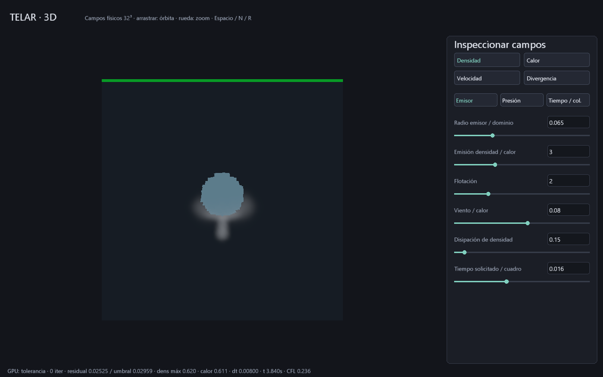

# Tiempo y colisión del humo 3D

El laboratorio `telar --humo-3d` añade **subpasos, predictor CFL calculado en GPU
y una esfera estática voxelizada**. Es el avance inicial de P2 del
[plan de explosión](PLAN-EXPLOSION-PRODUCCION.md); no completa aún colisionadores
móviles, mallas arbitrarias ni combustión.

## Controles del artista

En la pestaña **Tiempo / col.**, los números se aplican con Enter:

| Control | Rango | Inicial |
|---|---|---|
| Subpasos por cuadro | Entero 1..4 | 2 |
| Radio obstáculo | 0..0.3 del dominio; 0 desactiva | 0.16 |
| Altura del centro | 0.31..0.69 | 0.52 |
| CFL predictor | 0.1..1 celdas | 0.5 |

La esfera está centrada en X=Z=0.5. Su velocidad es cero, su frontera cierra las
caras entre celdas fluidas y sólidas y deja libre la componente tangencial.
Se dibuja la máscara voxelizada en azul: sus escalones muestran la resolución
real de colisión; no es una esfera geométrica de producción.

La pestaña Emisor controla el tiempo **solicitado por cuadro**, 0.001..0.04 s.
Espacio pausa, N ejecuta un cuadro de subpasos, R limpia campos/reloj y D obtiene
64 B de resumen. El contador CLI `--pasos` cuenta cuadros, no subpasos.
La cámara sigue funcionando en pausa. Los cambios de radio/altura conservan
campos; se corrigen al siguiente avance, no al editar pausado. R permite empezar
el ensayo desde cero. No hay equivalencia entre tiempo simulado y tiempo de pared.

## Qué decide la GPU

Antes de **cada subpaso**, un programa reduce máximos parciales de `abs(u)`,
`abs(v)`, `abs(w)` y calor; otro los combina en una sola invocación. Se reutiliza
el plano de parciales del solver, con barreras entre pasadas y sin atómicos.

Con `h=1/N`, tiempo solicitado `D`, subpasos `s` y CFL `c`:

```text
solicitado = D / s
cota = max(abs(u)) + max(abs(v)) + max(abs(w))
       + solicitado * max(abs(calor)) * (flotación + abs(viento))
dt = min(solicitado, c / (N * max(cota, 1e-6)))
```

Se incluyen fuerzas existentes para anticipar su efecto. La proyección puede
cambiar la velocidad posteriormente: este **predictor no prueba estabilidad
universal ni mide el CFL posterior**. Cada subpaso vuelve a medir el campo actual.
La advección sigue siendo semi-lagrangiana de primer orden, difusiva y no
conservativa. No hay trazado de características contra SDF ni garantía de ausencia
de filtración a través de obstáculos delgados o geometrías sin resolver.

Si se necesita un `dt` menor, se avanza menos tiempo. No se oculta el déficit
ni se ejecuta trabajo ilimitado para recuperarlo. El reloj GPU suma los `dt`
realmente utilizados después de una proyección no inválida. El usuario puede
aumentar subpasos o reducir el tiempo solicitado. Un presupuesto de presión
agotado permite avanzar con error visible; no significa convergencia.

## Colisión y presión

Una celda es sólida cuando su centro cae dentro de la esfera. Advección y fuente
anulan escalares/velocidades interiores; las muestras de celdas sólidas valen cero.
Las caras MAC que tocan sólido se fijan a cero en la velocidad provisional y final.
La presión y su residual usan exactamente los mismos vecinos abiertos y grado
variable. El divisor se protege para celdas sin vecinos; la presión dentro del
sólido se anula al iterar. Es una condición Neumann de pared estática, sin corte
fraccional de celdas, movimiento de pared ni acoplamiento bidireccional.

## ABI y consumo

Se conservan **17 planos** y la reserva lógica `68*N³+4 B`: 2 228 228 B a 32³,
más recursos gráficos, alineación, código y staging de diagnóstico. No se añade
buffer de colisión: la esfera se evalúa matemáticamente en los shaders.
Las comprobaciones adicionales y los subpasos aumentan el trabajo GPU; no hay
benchmark de FPS, pico físico o comparación de velocidad contra Houdini.

El plan temporal contiene 16 programas únicos y `(9+5*(iter/2))*s` posiciones:
338 con 64 iteraciones y dos subpasos; máximo 1316 con 128 y cuatro. El backend
admite hasta 2048 posiciones, también al cambiar la secuencia. La CPU compone
un plan nuevo al cambiar presupuesto/subpasos y registra sus posiciones; la GPU
decide el dt y la convergencia. No hay descarga de campos para esas decisiones.

Constantes adicionales: `[13]=subpasos`, `[14]=radio`, `[15]=altura`, `[19]=CFL`.
El control conserva las primeras diez palabras de presión y añade:

| Palabra | Dato del último subpaso |
|---|---|
| 10 | dt efectivo |
| 11 | Cota predictora de velocidad |
| 12 | Desplazamiento predictor en celdas |
| 13 | Tiempo acumulado tras proyección no inválida |
| 14 | 0 normal, 1 limitado por CFL, 2 dato temporal inválido |

Se requieren constantes físicas finitas y dentro de los dominios de la UI.
Los editores rechazan subpasos fraccionarios y no aplican valores inválidos.
La inspección D descarga las mismas dieciséis palabras, una sola vez por petición.

## Guardado y pruebas

`.tlar` **v10, 72 B**, almacena diez parámetros comunes y cuatro de tiempo/esfera,
con CRC de carga útil. Guarda configuración, no campos ni reloj ni cámara.
V9 se abre como un subpaso, radio cero, altura 0.52 y CFL 0.5; conserva los diez
parámetros. V8 2D se rechaza. Los archivos mayores de 72 B también se rechazan.

`telar-app/tests/volumen_gpu.rs` valida los 16 programas y el visor con `spirv-val`.
Compara 14 planos tras dos subpasos con fuerzas/esfera contra referencia escalar
independiente a 9³ (error absoluto <0.0003); comprueba el recorte de tiempo,
reloj, caras cerradas exactamente a cero, campos interiores nulos, repetibilidad
y diferencia al desactivar la esfera. Continúa verificando el modo anterior.
También se prueba el plan máximo de 1316 posiciones con cuatro subpasos. Las pruebas de UI verifican Enter, decimal con coma, enteros y rechazo transaccional.
El formato prueba CRC y migración v9. La reapertura nativa de v9/v10 con 120 cuadros y redimensionado terminó sin avisos Vulkan.

Captura real RTX 3060, Windows 11, 240 cuadros/480 subpasos: tiempo simulado
3.840 s, último dt 0.008 s, predictor 0.236 celdas, residual 0.02525 frente a
umbral 0.02959, cero avisos Vulkan del producto. No es un benchmark contra Pyro.



La separación conceptual entre subpasos, CFL y colisiones se estudia en la
[documentación pública de Pyro Solver Sparse](https://www.sidefx.com/docs/houdini/nodes/dop/pyrosolver_sparse.html).
TELAR usa implementación y contratos propios; la comparación con Houdini permanece **ABIERTO**.
