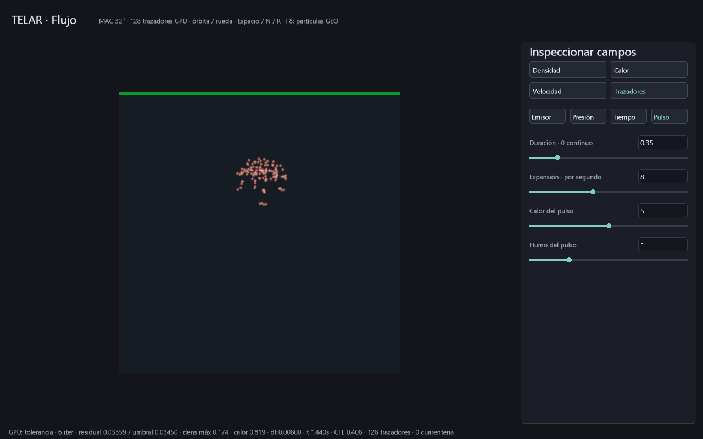

# Trazadores pasivos acoplados al humo GPU

Primera conexión física de P5 con P1/P3: 128 puntos siguen las caras de velocidad
MAC ya proyectadas de humo/explosión, dentro del mismo buffer GPU. El emisor
independiente `--particulas` conserva sus controles y dinámica propios.

Referencia conceptual: [POP Advect by Volumes, documentación pública de SideFX](https://www.sidefx.com/docs/houdini/nodes/dop/popadvectbyvolumes.html)
describe transportar partículas mediante un campo de velocidad. TELAR implementa
su propio transporte directo de posición, con alcance y pruebas propios. No es
código de Houdini ni un clon de todas las opciones de ese operador.

## Abrir y controlar

```powershell
cargo build -p telar-app --release
.\target\release\telar.exe --explosion --trazadores
.\target\release\telar.exe --humo-3d --trazadores
.\target\release\telar.exe --explosion --trazadores --pasos 90 --exportar-geo target/flujo.geo
.\target\release\telar.exe --inspeccionar-geo target/flujo.geo
```

**TELAR Trazadores.cmd** abre el pulso con trazadores. El modificador requiere
humo 3D o explosión; rechaza humo 2D y partículas independientes.
Cuarta vista **Trazadores** muestra solo puntos; las otras conservan densidad,
calor y velocidad del gas. La barra verde/amarilla/roja sigue diagnosticando
presión del volumen. No certifica por sí sola la calidad del transporte.

Se editan los parámetros existentes del gas con deslizadores o número y Enter:
radio de fuente, emisión, flotación, viento, disipación, dt, presión, subpasos,
obstáculo, CFL y pulso. Modifican el flujo que guía los puntos. En esta entrega
cantidad=128, vida=2 s, escala de velocidad=1 y radio visual=0.008 son fijos;
no se presentan como controles independientes. Fuente en retícula determinista
4×8×4, sin semilla aleatoria, centrada en el mismo emisor del MAC y escalada por
su radio. Nace aunque emisión de densidad sea cero: sirve para inspeccionar flujo,
no detecta fuego, calor ni rotura física para generar chispas.

Espacio pausa; N avanza un cuadro con sus subpasos; R limpia volumen, plazas y
reloj. D lee diagnóstico; F8 exporta trazadores vivos. F5/F9 guardan/abren la
configuración física v11 del volumen; **el modificador no se guarda en `.tlar`**.
Reabrir usando `--explosion --trazadores --abrir-escena archivo.tlar` conserva el
modo; reinicia campos y puntos. No hay caché reanudable ni historial de trayectorias.

## Contrato numérico y sincronización

Después de proyectar velocidad, el último programa del subpaso calcula diagnóstico
y transporta las plazas. Son los mismos dieciséis programas y el mismo orden
acotado del MAC; no se agregan despachos ni se amplían las FFI Vulkan.
Cada invocación 0..127 posee una plaza. Solo lee velocidad proyectada y constantes;
escribe exclusivamente la cola de partículas. La barrera previa a diagnóstico
separa la proyección. El reloj inicial se lee en control[16], congelado antes
del subpaso: no compite con la escritura del reloj final control[13].

Para posición normalizada P, la muestra de componente e usa coordenadas de rejilla
`P*N - offset`, con offset 1 en su eje y 0.5 en los otros dos. Se interpolan ocho
caras por componente con el mismo halo cero y máscara de celdas de la esfera del
solver. Se aplica **Euler explícito** `P_nuevo=P+v_MAC(P)*dt_GPU` y se conserva
esa velocidad muestreada en el atributo v; no se vuelve a muestrear en P_nuevo.
No se aplica gravedad, impulso balístico ni arrastre del emisor independiente.

Acoplamiento unidireccional: el gas mueve puntos; los puntos no ejercen fuerzas
ni modifican densidad/calor/presión. El dt es el seleccionado por CFL para ese
subpaso, no una estimación host. No se subdivide adicionalmente por partícula.

Una plaza inactiva nace al inicio del subpaso si la fuente está abierta y la
generación permite un id nuevo. Duración cero mantiene la fuente; duración positiva
usa reloj inicial < duración. Todas las plazas iniciales nacen juntas. Vida alcanza
2 s: muere; fuente continua permite reciclar al siguiente subpaso. Id estable por
vida `generación*128+plaza`; al llegar a generación 65535 deja de renacer, sin wrap.
El reloj es el del MAC; no añade el límite de 3600 s del emisor independiente.

Salir del dominio unitario o terminar en celda sólida mata el punto. Es una prueba
de destino, no detección continua: puede saltarse un obstáculo delgado. Campo
interpolado cero dentro de sólidos y halo cerrado no sustituyen un solver de
colisiones. La fuente puede generar plazas en sólido si el artista lo coloca allí;
se eliminan por el mismo criterio de destino.

Estado inválido de plaza o muestra no finita/extrema se aísla con bandera -1 antes
de convertir destinos a índices. Valores previos se conservan para diagnóstico.
R limpia; GEO rechaza cuarentenas. Con dt cero o presión inválida el transporte
no avanza plazas válidas. No es recuperación general frente a memoria corrupta.

## Reserva y coste

Diecisiete planos MAC de N³ palabras, seguidos por doce planos de 128 palabras
para partículas: XYZ, vXYZ, age, life, generación, birth_time, estado y reserva.
La cola ocupa 6144 B; el plano final de reserva no se usa. El backend asigna planos
completos: `17+ceil(1536/N³)`, 8..64 celdas por lado. A 8³ son veinte planos;
a 32³ dieciocho: **2359300 B lógicos** incluyendo los 4 B del backend, 131072 B
más que MAC solo. De esa ampliación 124928 B quedan como relleno sin usar.
No incluye imágenes, pipelines, alineación ni interfaz.

Por subpaso se añaden hasta 128 interpolaciones vectoriales y pruebas de destino;
los demás hilos saltan la cola. No hay atómicos float ni descarga por cuadro estable.
Vista de trazadores: O(píxeles*128), splats gaussianos aditivos hasta 512².
La rama evita integrar el volumen en esa vista; otras vistas conservan raymarch.
Sin profundidad, oclusión por humo, sombras, estelas ni render de producción.
No se han medido FPS, tiempo GPU ni pico físico de VRAM.

D descarga 576 B (64 de resumen MAC y 512 de banderas). F8 descarga **5700 B**
(68 de control y 5632 de atributos), convierte/valida y escribe en CPU. Son
operaciones explícitas y bloqueantes; la CPU sigue a cargo de ventana, eventos,
cámara, archivos, constantes y envíos Vulkan. No se promete CPU ausente.

GEO usa el perfil de ocho atributos ya documentado en [INTERCAMBIO-GEO.md](INTERCAMBIO-GEO.md).
Solo vivas, orden por plaza, edad/vida/nacimiento reales. density=1 y heat=1-age/life
son máscaras visuales, no densidad/temperatura del gas. No preserva generaciones
muertas ni todo el estado del solver; no permite reanudar. Destino nuevo obligatorio.
Comparación externa Houdini/Partio: **ABIERTO**.

## Evidencia, RTX 3060 / Windows, 28-10-2026

- SPIR-V de los dieciséis programas y del visor validado para Vulkan 1.3.
- Campo afín fabricado en caras: contraste de componentes y posiciones con
  solución analítica y referencia escalar; error absoluto <0.00002.
- 36 cuadros de dos subpasos: los primeros diecisiete planos son idénticos,
  byte por byte, con/sin trazadores. El flujo sí cambia sus posiciones/velocidades.
- Ciclo continuo/reciclaje, cierre de fuente, muerte, esfera, cuarentena, límite
  de generación, presión inválida y dt cero probados; pausa/vistas y GEO no mutan estado.
- Ejecución nativa 32³, 90 cuadros: 128 vivas, cero cuarentena, t=1.4400015 s,
  dt=0.008 por subpaso, presión en tolerancia; cero avisos Vulkan del producto.
  P exportada de [0.37530053,0.67417806,0.35217926] a [0.6601738,0.9611691,0.6478238].
- Reabrir v11 y ejecutar 120 cuadros con dos redimensionados: cero avisos.
- `cargo verify`: guardián, rustfmt, clippy pedantic y toda la suite correctos.



Pruebas: `telar-app/tests/trazadores_gpu.rs`; referencia escalar de ensayo en
`telar-kernel/src/trazadores_referencia.rs`. El producto no simula puntos en CPU.

## Siguiente trabajo de P5

Separar parámetros de trazadores en un contrato guardable, emisión por campos y
semilla, integración de mayor orden, estelas con historial y acoplamiento de
partículas inerciales. Después, fragmentos y colisiones continuas. Siguen pendientes
combustible/reacción de P3, iluminación volumétrica de P4 y cachés de P6; esto no
convierte la explosión en un plano de producción terminado.

Actualización 29-10-2026: la rama separada [PLANO-VFX.md](PLANO-VFX.md)
implementa parámetros v13, umbral de calor, inercia, semilla e historial corto,
junto con reacción, iluminación simple y caché. Este modo pasivo conserva su
contrato original; la comparación profesional continúa abierta.
