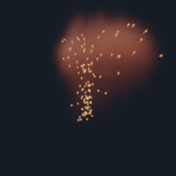

# Chispas y estelas dentro de Belleza

29-10-2026: `telar --plano-vfx` dibuja los secundarios junto con el volumen,
en el visor y en la salida HDR. En la página Detalle, **Brillo chispas / estelas**
controla ambas contribuciones entre 0 y 10; cero las apaga. El pase Partículas
mantiene la inspección sin extinción del humo. Calor y Combustible conservan su
diagnóstico independiente. El contrato .tlar v13 y la memoria física no cambian.

Captura real RTX 3060, 80 avances, tiempo simulado 1.126 s, 256²/4 spp.
La resolución del solver sigue siendo 32³: el volumen suave de esta captura
no representa detalle de producción. No se han añadido filtros a la imagen.

## Cálculo residente

Cada píxel acumula primero el volumen y luego la emisión de hasta 128 puntos
gaussianos y sus cuatro segmentos de historial. Para Belleza, cada aporte se
multiplica por `T = exp(-integral(densidad * extincion * ds))` entre ojo y
secundario. En una estela se evalúa la transmisión al punto del segmento más
próximo al rayo; es una aproximación, no integración volumétrica de un cilindro.

La integral usa ocho puntos medios sobre hasta 1.8 unidades desde el secundario
hacia el ojo. La diagonal del cubo unitario es menor que 1.8 y los secundarios
válidos están en ese dominio. Las muestras exteriores son cero. Se incluye la
esfera voxelizada del laboratorio como extinción 40; no equivale a intersección
exacta con superficies. Su aparición como geometría opaca primaria sigue abierta.

Se omiten coberturas gaussianas <=1e-5 antes de integrar transmisión. La CPU
no calcula coberturas ni mezcla píxeles: sigue enviando trabajo/constantes e
interfaz. No se añaden buffers, transferencias por cuadro ni E/S automática.
El coste GPU aumenta: hasta cinco integraciones de ocho muestras por secundario
y píxel con cobertura significativa, más las evaluaciones gaussianas. No se
ha medido duración GPU ni se promete rendimiento gratuito o equivalencia Houdini.

Son emisores aditivos atenuados; no absorben luz, no se ocultan entre sí y no
iluminan el gas. Faltan radios físicos, iluminación desde chispas, geometría
general y estructuras de aceleración antes de aumentar masivamente la cantidad.

## Pruebas

`telar-app/tests/vfx_compuesto_gpu.rs` ejecuta el shader final en Vulkan real:
verifica aporte en Belleza, menor transmisión detrás de más humo, concordancia
aproximada con Beer–Lambert, brillo cero/doble, rechazo detrás del ojo, estelas
visibles y pase diagnóstico independiente de densidad. `vfx_gpu.rs` valida el
SPIR-V de ambas rutas y comprueba que el render no modifica la simulación.

La captura nativa de 80 avances y los cuatro pases HDR terminaron con cero
avisos contabilizados de validación. Modelo de transmisión documentado en
[PBRT](https://www.pbr-book.org/4ed/Volume_Scattering/Transmittance); implementación
propia sin bibliotecas externas. [Estado y pendientes generales](PLANO-VFX.md).
