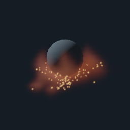

# La esfera de colisión participa en el render VFX

29-10-2026. Belleza representa el obstáculo con una esfera analítica opaca,
material mate azul gris y luz puntual. Se integra el volumen solo hasta el
impacto; el humo y las chispas delante siguen visibles. Los secundarios detrás
o dentro de la esfera quedan bloqueados. La luz también usa intersección
analítica para la sombra de la esfera; el humo conserva integración numérica.



Salida GPU real RTX 3060, 80 avances, tiempo simulado 1.008 s, 256² a 8 spp.
Captura sin retoque ni filtros externos. En esta ejecución: tolerancia de presión
alcanzada, 14 iteraciones, 115 trazadores vivos y cero en cuarentena.

## Abrir el ejemplo

```powershell
.\target\release\telar.exe --plano-vfx --abrir-escena referencias/plano-vfx-esfera.tlar
```

La escena propia de TELAR es .tlar v13 de 200 B, guardada por el programa.
Radio 0.18, altura 0.42, fuente en (0.5, 0.2, 0.5), pulso de 0.35 s y resto
del preset reactivo. No contiene caché; abre vacío y empieza a simular.
En la página Tiempo (3/9) se modifican Radio y Altura; radio cero desactiva el
obstáculo tanto en física como en render. F5 guarda y R reinicia la simulación.
Moverlo durante una simulación no implementa un colisionador dinámico físico:
para comparar resultados, modifica parámetros y reinicia.

## Contrato matemático y costes

La GPU resuelve la cuadrática rayo–esfera para centro (0.5, altura, 0.5) y radio
del mismo bloque de parámetros que utiliza el solver. Se limita el intervalo
primario antes de hacer los 64 pasos. La transmisión del humo multiplica el
color de la superficie; sobre esta se suma la emisión del volumen delantero.
La superficie usa respuesta difusa Lambert, sombra del humo con ocho muestras
y un término de ambiente fijo 0.04. No es GI ni un material de producción.

Las rutas ojo–secundario y muestra–luz comprueban si existe impacto antes del
destino. Un sesgo de 1e-4 evita autointersección en segmentos; para iluminar la
superficie se desplaza el origen 0.001 sobre su normal. Cámara dentro de la
esfera se trata como interior opaco con recorrido primario cero; no es un visor
de paredes interiores. La normal degenerada se protege para evitar NaN.

La simulación sigue representando la esfera mediante centros de vóxel a 32³,
mientras el render usa su superficie continua: existe discrepancia de contorno
de hasta el orden de una celda. No se ha implementado colisión de mallas,
material editable, reflexión, refracción, luz de área ni emisión del fuego
que ilumine la esfera. Los pases diagnósticos permiten ver campos y partículas
a través del obstáculo y mantienen su propósito de inspección.

CPU: mismos parámetros, interfaz y envíos; sin intersecciones ni mezcla de
píxeles del producto en host. GPU añade cuadráticas y sombreado de superficie;
reemplaza las antiguas ocho comprobaciones voxelizadas de esfera por segmento.
No añade buffers ni descargas por cuadro. Reserva lógica VFX sin cambios:
4 063 236 B, más imágenes, staging, alineación y pipelines del backend. No se
han medido duración GPU, FPS ni pico físico; no se anuncia mejora de velocidad.
RAM/E/S nuevas: escena de 200 B y capturas explícitas de documentación.

## Evidencia y siguientes pasos

`telar-app/tests/vfx_compuesto_gpu.rs` comprueba una superficie conocida sin
luz, secundarios delante/detrás/dentro, bloqueo con radio pequeño, estelas,
calor completamente detrás, rayo que no toca la esfera y cámara en su centro
sin valores no finitos. `vfx_gpu.rs` valida los programas SPIR-V y confirma
que el render no modifica los campos de simulación.

La demo nativa produjo visor y PFM/PPM HDR con cero avisos contabilizados de
validación. Falta extender esta unión a geometría general, medir coste por
pasada, aumentar resolución de campos y añadir herramientas artísticas.
La comparación con Houdini continúa **ABIERTO**; el ejemplo es propio,
etiqueta **DISTINTO**, sin código ni datos extraídos de Houdini.
