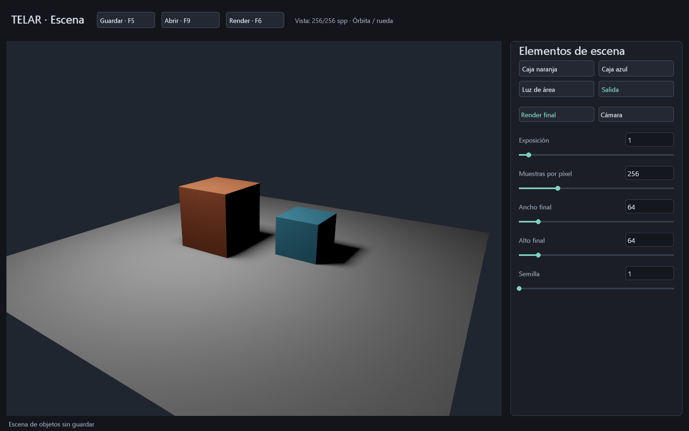

# Acumulación progresiva en GPU

Entrega del **28 de octubre de 2026**. El modo `--estudio-rayos` conserva un
historial HDR por píxel y añade una muestra por fotograma hasta el límite elegido.
La imagen mejora mientras la escena permanece quieta. Usa el mismo integrador
de iluminación directa del render final; no añade todavía rebotes de luz.



## Uso y controles

Abre `TELAR Objetos.cmd` o `telar --estudio-rayos`. El contador de la cabecera
muestra los pasos de acumulación enviados y el objetivo de muestras. Es estado
de presentación con posible retraso de los fotogramas en vuelo; no se descarga
un contador GPU por fotograma.

En **Salida → Render final**, «Muestras por píxel» controla tanto el objetivo del
visor como la calidad del HDR independiente. Conserva el presupuesto guardable
de la escena: hasta 512 por eje, 1024 spp y ancho final × alto final × spp <=1048576.
Para elegir 256 spp, pon primero ancho/alto final en 64×64. Esto no reduce la
resolución física del visor, limitada por separado a 1024×768.

| Cambio confirmado | Historial |
|---|---|
| Cámara, objeto, tamaño, color, visibilidad, luz o sombras | Se reinicia a cero |
| Muestras, semilla o resolución final | Se reinicia a cero |
| Tamaño de ventana o formato de presentación | Se reconstruye y reinicia |
| Exposición | Conserva suma y contador; solo cambia la visualización |
| Selección de elemento o página | Conserva el historial |

Los arrastres de cámara/parámetro se aplican al soltar; el visor mantiene la
escena anterior durante el arrastre. Redimensionar requiere reconstruir de
inmediato la reserva visible. El texto sin confirmar no cambia la escena.
Reabrir el programa/proyecto empieza un historial nuevo; no se guarda en `.tlar`.

F6 sigue ejecutando el render final en su trabajador independiente, con progreso
y cancelación. Ese trabajo usa la resolución/aspecto de salida, mientras el visor
usa el aspecto de su área visible. No se reutiliza automáticamente el historial
del visor para exportar otra resolución o cámara de recorte.

## Pasadas y propiedad de datos

Por píxel se reservan cuatro u32 (16 B): tres contienen la suma RGB float32 y uno
el número de muestras. El GPU inicializa toda la reserva a cero. En cada cuadro:

1. Una barrera espera las lecturas/escrituras anteriores del mismo historial.
2. Un kernel compute con grupo X=64 lee el contador. Si no alcanzó el objetivo,
   calcula un rayo de cámara con muestreo subpíxel, luz y sombra; suma radiancia
   y aumenta el contador. Una invocación posee un píxel: no hay sumas atómicas.
3. Otra barrera publica las escrituras para el shader de fragmentos.
4. El fragmento muestra `suma/max(contador,1)`, exposición, Reinhard y transferencia
   de color apropiada. Después se compone la interfaz.

Al alcanzar el objetivo, el kernel deja de trazar rayos para ese píxel; aún se
despacha, comprueba el contador y se dibuja la media. No es coste cero.
Las dependencias se emiten fuera del renderizado, sobre la misma cola, incluyendo
fotogramas en vuelo. Referencia de alcance y visibilidad:
[vkCmdPipelineBarrier](https://docs.vulkan.org/refpages/latest/refpages/source/vkCmdPipelineBarrier.html).

No se necesita escribir buffers desde fragmentos ni habilitar atomics/fragment
stores: las escrituras ocurren en compute y la visualización solo lee. El backend
continúa aislado del modelo de iluminación; recibe shaders y el contrato de
cuatro palabras por píxel en set 0/binding 1.

## Coste y límites

Reserva lógica adicional de historial: **16 × ancho × alto + 4 B** (buffer auxiliar
para el layout compartido). Máximo 12 MiB + 4 B a 1024×768, más alineación, código,
descriptores y adjuntos de presentación existentes. Solo hay un historial compartido
por los dos fotogramas en vuelo, ordenado mediante barreras. No duplica las muestras
ni pierde la mitad de los pasos en dos historiales independientes.

La CPU envía 128 B de constantes y comandos normales; no calcula radiancia ni
descarga sumas en vivo. Recompilar/crear recursos al editar sigue teniendo coste y
puede esperar al driver. Convivir con el render final puede aumentar el tiempo GPU
del cuadro. Pico físico completo y latencia comparativa permanecen **ABIERTOS**.

`inspeccionar_historial` y `capturar_historial_interfaz` son diagnóstico explícito:
esperan y descargan. La captura ejecuta un paso adicional si falta alguna muestra;
no se llaman en el bucle vivo del producto.

## Verificación

En NVIDIA GeForce RTX 3060 / Windows, cero avisos de validación:

- Reserva 17×13 (grupo final parcial): todos los píxeles comienzan en cero,
  llegan a 1 y después a 8. Tres cuadros adicionales conservan exactamente los
  mismos bytes al alcanzar el límite. Recrear el historial vuelve a una muestra.
- **IGUAL dentro de tolerancia:** media RGB frente al integrador por lotes,
  error absoluto <2e-5; contadores exactos. Cambiar exposición tras converger
  conserva exactamente el historial.
- Validación oficial SPIR-V para Vulkan 1.3. Pruebas de la política de reinicio,
  compatibilidad de escenas, redimensionado y render final asíncrono.
- Capturas reales a **1, 16 y 256 spp**, verificando que los 640320 píxeles del
  viewport 920×696 tienen el contador esperado. Reproducción:

```powershell
cargo run -p telar-app --example capturar_progresivo -- target/progresivo
```

No hay denoiser: más muestras reducen el ruido observado, pero no garantizan una
imagen perfecta ni reducción monótona de error en cada píxel. Las caras sin luz
directa continúan oscuras porque todavía no calculamos iluminación indirecta.
Faltan BVH, muestreo adaptativo por error, rebotes, reflejos/refracción y materiales
avanzados. El siguiente avance debe construir sobre este historial verificable.
